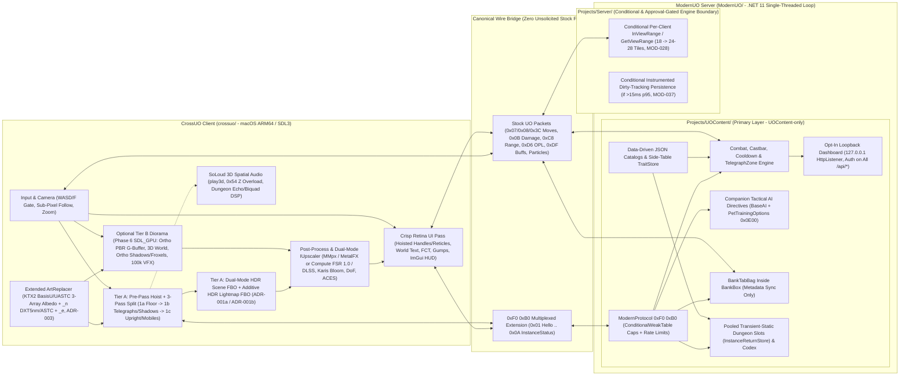

# PRD: Britannia HD-2D 2027 — Modernizing CrossUO & ModernUO into a 2026/2027 Retro MMORPG

> **Document Status:** Canonical Program PRD (v2.0 — Round-6 Goldfish-Hardened; Ready for ADR Gate)  
> **Program Name:** Britannia HD-2D 2027 — Modernizing CrossUO & ModernUO into a 2026/2027 Retro MMORPG  
> **Workspace:** Paired `ultima-online-local` (`crossuo/` client fork + `ModernUO/` server fork; separate Git histories) built inside an isolated sibling sandbox `../ultima-online-hd2d/` (`MOD-000`, port `2594`) so live `ultima-online-local/` (port `2593`, live `Saves/`) stays 100% untouched  
> **Target Baseline:** macOS Apple Silicon (`arm64`, Retina HiDPI, CrossUO `RENDER_AUTO=ON` -> OpenGL 4.1 Core -> native `SDL_GPU` Metal/Vulkan/DX12, governed by `ADR-001a` / `ADR-001b` / `ADR-006`) & ModernUO (`net11.0`, `LangVersion 15`, `TreatWarningsAsErrors=true`, single-threaded event loop)  
> **Companion Documents:** [`BACKLOG.md`](BACKLOG.md) · [`BACKLOG.csv`](BACKLOG.csv) · [Shared Development Guide](../README.md)

---

## 1. Problem Statement, Target Scale & Goals / Non-Goals

### 1.1 Problem Statement

Ultima Online's sandbox gameplay, open skill economy, and hand-crafted isometric art remain timeless, yet playing the paired **CrossUO** client and **ModernUO** server on modern 1440p/4K Retina Apple Silicon displays exposes compounding visual, interaction, and operational friction:

- **Visual & Display Limitations:** While launcher/asset-viewer `win_init` (`gfx.c`) already enables `SDL_WINDOW_HIGH_PIXEL_DENSITY`, the main game window (`CGameWindow::Create` in `GameWindow.cpp`) omits it—blurring text and UI under macOS compositor upscaling. CrossUO also skips lighting whenever `g_PersonalLightLevel >= g_LightLevel` (since `UseLight = (g_PersonalLightLevel < g_LightLevel)`, e.g., daytime `0 >= 0`), clamps light accumulation in an 8-bit `GL_RGBA8` lightmap without HDR or tone mapping, renders mobile-only unbatched shadows and unbatched CPU line/quad weather, lacks animated water shaders, and quantizes `ArtReplacer` overrides down to 16-bit RGB555 (`GL_RGB5_A1`) or `RGBA4`.
- **Interaction & Combat Readability Gaps:** Movement truncates step offsets to `(char)` integers causing camera jitter; inventory relies on overlapping free-form bag gumps without search or stat-delta item comparison cards; combat audio is 2D stereo; and stock packets (`0x0B` damage, `0xD6` OPL capped at `MaxArgumentLength = 504` characters per property argument / ~1,008 bytes UTF-16LE, `0xDF` buffs) cannot convey structured cast bars, cooldown timers, elemental/crit combat events, or shader-drawn boss AoE telegraphs.
- **Content & Operations Friction:** Crafting recipes, loot tables, and encounter archetypes are largely hard-coded in C#; solo/small-group instanced boss encounters lack a unified transient-slot lifecycle and companion AoE-avoidance directives; and local shard operators lack an opt-in loopback diagnostic dashboard or profiled save-pause budget.

### 1.2 Target Scale & Operating Envelope

**Primary Target Workload:** **Britannia Solo and small co-op Apple Silicon shards** running **1–16 concurrent players** with **~100,000–500,000 persisted world entities**, scaling cleanly to small private shards (up to ~64 concurrent players) without regressing single-threaded server loop latency or client frame pacing.

### 1.3 Visual Art Direction Pillars

All rendering, shader, lighting, particle, and UI decisions are governed by two complementary owner-requested art-direction pillars:

1. **Octopath Traveler II & Final Fantasy Resonance (HD-2D Diorama Craft):**
   - **Motivated multi-source colored lighting:** warm flickering tavern lanterns, dappled canopy sunbeams, cool stained-glass moonlight, and active spell illumination operating cleanly across daytime, dusk, night, and dungeon scenes.
   - **Subtle play-plane tilt-shift Depth-of-Field (DoF) & atmospheric depth haze:** gentle focal band anchored to the player's isometric play plane with tack-sharp combat clarity and smooth atmospheric fog-of-war horizon falloff.
   - **Surface & material response:** animated Fresnel/wave shimmer and masked 2D reflections on water (`IsWet`), ambient-temperature sprite rim-lighting, and—in Phase 4 HD asset packs—per-pixel normal (`_n`) and emissive/roughness (`_e`) surface response.
2. **Diablo IV & Path of Exile 2 (Dark Gothic Chiaroscuro & Combat Weight):**
   - **Grounded dark chiaroscuro palette:** deep obsidian and slate shadows anchored by controlled warm amber and spectral highlights. **Strict anti-goal:** no washed-out pastel bloom or low-contrast over-brightening; ACES/filmic tone mapping must preserve dark-dungeon mood and silhouette contrast.
   - **High-contrast combat readability:** shader-rendered ground combat telegraphs (circles, cones, lines, rings with fill sweeps) composited cleanly **beneath** character silhouettes and overhead UI.
   - **Tactile combat weight:** sub-pixel smooth camera/movement interpolation, crisp Retina floating combat typography (crit, elemental school, heal, parry/miss), subtle target hit-flash, optional micro-hit-stop, and controlled directional camera shake.
   - **Dark ornate obsidian/bronze UI chrome:** opt-in ImGui Modern HUD featuring instant-read stat-delta item cards, searchable grid inventory, corpse quick-loot, and searchable bank stash tabs.

### 1.4 Program Goals & Non-Negotiable Invariants

- **G0 — Isolated Parallel Development Sandbox Prerequisite (`MOD-000`, Wave 00):** Provision a completely isolated sibling workspace (`../ultima-online-hd2d/`) via an idempotent bootstrap script (`setup-hd2d-sandbox.sh`) using Git worktrees (`hd2d/modernuo` from `codex/solo-shard`; `hd2d/crossuo` from `codex/solo-client`), dedicated shard port **`2594`** (concurrent play with live `2593`), a one-way snapshot copy of `ultima-online-local/ModernUO/Distribution/Saves/` into `../ultima-online-hd2d/ModernUO/Distribution/Saves/` (never symlinking or touching live saves), rewritten `modernuo.json` (`127.0.0.1:2594`, isolated `Archives`/`Backups`/`pathfinding.recorder.path`), isolated `runtime/crossuo-build-hd2d/` and CrossUO `127.0.0.1,2594` profiles, read-only symlinks to all 3 game-data directories (`runtime/UO_Classic`, `runtime/ModernUO-maps`, `runtime/Scale-Lined-Plate-Profile`) plus `runtime/{dotnet,dotnet-home,nuget}`, and a sandbox launcher preserving `DYLD_FALLBACK_LIBRARY_PATH`—so the owner can keep playing and editing live `ultima-online-local/` untouched while Britannia HD-2D is developed.
- **G1 — Tier A Stock-Art Transformation First (Phase 1):** Deliver an unmistakable *Octopath Traveler II* / *Diablo IV* HD-2D chiaroscuro visual leap on stock UO artwork at >= 60 FPS on Apple Silicon 1440p/4K Retina before committing to optional 2×/4× HD asset packs or backend rewrites.
- **G2 — Modernize UX & Combat Feel Without Replacing Classic UO (Phase 2):** Ship an opt-in dark-gothic Modern HUD, searchable inventory/corpse loot, stat-delta tooltips, sub-pixel motion, opt-in WASD/`F`, and 3D spatial audio by extending CrossUO's existing Dear ImGui 1.92, `AssetTextureCache`, `InventoryAgent`, and SoLoud subsystems.
- **G3 — Structured Capability-Negotiated Telemetry (Phase 3):** Introduce a single multiplexed `0xF0 0xB0` wire extension with zero unsolicited traffic to stock clients, powering authoritative cast bars, cooldowns, telegraphed bosses, companion AoE dodging, rich combat events, and bank stash-tab metadata.
- **G4 — Tier A High-Ceiling Native `SDL_GPU` & HD Art (Phase 4):** Elevate **native `SDL_GPU` (Metal / Vulkan / DX12)** as the recommended backend foundation for Tier A -> Tier B (`ADR-001b`), paired with conditional 2×/4× normal-mapped KTX2 universal asset packs (`ADR-003`) gated on Phase 1 telemetry and confirmed art supply.
- **G5 — Save-Safe Server Modernization (Phase 5):** Add `[UOContent-only]` data-driven JSON catalogs, side-table component traits, pooled transient-static instanced dungeons + Codex, and an opt-in loopback `HttpListener` dashboard; gate engine-level incremental dirty-tracking persistence (`ADR-004`) strictly on Phase 0 profiling (`> 15 ms` p95 `World.Snapshot()`) plus full core entity dirty-tracking instrumentation and byte-equivalence verification.
- **G6 — Optional Tier B Hybrid 2.5D/3D PBR Diorama & Super-Resolution (Conditional Phase 6, `MOD-039`–`MOD-043`, `CrossUO`-only):** On top of `SDL_GPU` (`ADR-001b` + `ADR-006`, zero `Projects/Server/` edits), deliver an orthographic hybrid 2.5D/3D PBR diorama renderer (deferred PBR G-Buffer + 2D motion vectors, procedural chunked `map*.mul` terrain/cliff extrusion + curated tile-class templates or PBR-lit isometric cards/proxy shadow volumes for thin walls/doorways/arches and `CMultiObject` player houses keeping upright PBR-lit UO sprites, single tightly-fitted orthographic directional sun shadow map + local torch/spell shadow atlas, aspect-derived orthographic froxel volumetric fog & god-rays, 100k compute GPU particles, and dual-mode `IUpscaler` supporting `MMpx`, `ADR-006`-gated `MetalFX` OR zero-patch pure-`SDL_GPU` compute `FSR 1.0 EASU+RCAS` + half-res bilateral temporal fog upsampler, and optional dynamic-load `DLSS`) selectable via `RendererTier` (`0=Classic`, `1=TierA_HD2D`, `2=TierB_Diorama`).
- **Invariant — 100% Classic Toggle & Reversibility:** Every Tier A/Tier B visual pass (`RendererTier`), Modern HUD panel, WASD/`F` binding, and 3D audio filter is opt-in and reversible back to Classic 1997 presentation without server restart or save migration (changing `SDL_WINDOW_HIGH_PIXEL_DENSITY` on `CGameWindow::Create` requires window recreation or client restart).
- **Invariant — 100% Stock-Client Wire Compatibility:** ModernUO never sends unsolicited `0xF0 0xB0` frames; un-negotiated clients receive canonical packets (`0x0B`, `0xC8`, `0xD6`, `0xDF`, particle telegraphs, nested bank bags, classic pet speech/context menus).
- **Invariant — Zero Save Breakage & Strict Engine Boundaries:** Every ModernUO capability is tagged **`[UOContent-only]`** or **`[Requires Projects/Server/ Approval]`** per [`ModernUO/CLAUDE.md`](../../../CLAUDE.md). All gameplay logic remains single-threaded on the main event loop.

### 1.5 Explicit Non-Goals

1. **No External Game-Engine Rewrite or 3D Character-Mesh Replacement:** We are not porting Ultima Online to Unity/Unreal/Godot or replacing UO's iconic upright isometric character, monster, and item sprites with 3D skeletal character rigs. Optional Phase 6 Tier B procedural terrain/wall diorama extrusion runs strictly inside CrossUO's native `SDL_GPU` backend while keeping upright PBR-lit UO sprites and instant Classic 1997 fallback.
2. **No Mandatory Custom Client or Stock Protocol Breakage:** Stock UO, ClassicUO, and un-negotiated CrossUO clients must continue to connect and play cleanly with zero protocol errors.
3. **No Multi-Threaded ModernUO Gameplay Logic:** We will not add locks, `ConcurrentDictionary`, or background-thread game-state mutations (`ModernUO/CLAUDE.md` rules #3 and #10).
4. **No POSIX `fork()` Copy-on-Write Persistence on macOS:** Disqualified under multi-threaded CoreCLR (`net11.0`) due to GC/ThreadPool/kqueue/libdispatch deadlocks.
5. **No Public Internet Web Dashboard or Cloud Services:** The Phase 5 dashboard binds strictly to `127.0.0.1` for local administration—no public exposure, external auth provider, or telemetry SaaS.
6. **No Copyrighted Game Assets, Live Saves, or Credentials in Git:** All `.mul`/`.uop` archives, local profiles, captures, secrets, and live world saves stay outside commits and agent artifacts.
7. **No Edits Outside Paired Repositories:** All implementation work remains strictly within the paired `ModernUO/` and `crossuo/` repositories.

---

## 2. System Architecture Overview

Britannia HD-2D 2027 preserves strict repository ownership across the paired workspace—built inside the isolated sibling sandbox `../ultima-online-hd2d/` (`MOD-000`, port `2594`, leaving live `ultima-online-local/` on port `2593` and live `Saves/` completely untouched): **`crossuo/`** owns all client rendering (`RendererTier`: `0=Classic`, `1=TierA_HD2D`, `2=TierB_Diorama`), HD-2D & Tier B PBR shaders, asset decoding, ImGui Modern HUD overlays, camera/input handling, spatial audio, and client packet decoding, while **`ModernUO/`** owns all authoritative gameplay rules, combat math, inventory legality, world saves, and server packet emission.

Inside `ModernUO/`, all modernization features default to **`Projects/UOContent/`** (`[UOContent-only]`). Only two conditional, explicitly approval-gated capabilities touch **`Projects/Server/`** (`[Requires Projects/Server/ Approval]`): optional per-client dynamic viewport streaming (`> 18` tiles, `MOD-028`) and conditional incremental dirty-tracking persistence (`MOD-037`, triggered only if Phase 0 profiling measures `World.Snapshot() > 15 ms` p95). Phase 6 Tier B (`MOD-039`–`MOD-043`) is 100% `CrossUO`-only with zero server edits.

In the diagram below:
- **Solid arrows (`-->`)** denote synchronous in-process data, render-pass, or gameplay-hook flow.
- **Bidirectional arrows (`<-->`)** denote client-server network exchanges across the wire boundary (`0xF0 0xB0` for negotiated HD-2D clients; stock UO packets for all clients and stock fallbacks).
- **Dashed arrows (`-.->`)** denote asynchronous/event-driven triggers from world events into 3D spatial audio.



---

## 3. Alternatives Considered

Every major architectural direction was evaluated against concrete alternatives across cost, performance, complexity, and long-term maintainability. Where an ADR remains open (`ADR-001a`, `ADR-001b`, `ADR-002`, `ADR-003`, `ADR-004`, `ADR-005`), this section frames the trade-off space without pre-deciding the `/advisory-board` verdict.

| Decision Area | Evaluated Options | Trade-Off Analysis (Cost / Performance / Complexity / Maintainability) | Program Posture |
| :--- | :--- | :--- | :--- |
| **(a) World Presentation** | **1. HD-2D Orthographic Enhancement** (HDR lighting, post-process, optional 2×/4× normal-mapped sprites) vs. **2. Full 3D Mesh World Rewrite** | Full 3D rewrite erodes UO's iconic pixel silhouettes, requires authoring thousands of 3D meshes/rigs (multi-year asset cost), and breaks classic art-pack compatibility. HD-2D orthographic enhancement transforms 100% of stock art in Phase 1 with low asset cost and instant Classic toggle. | **Selected:** HD-2D Orthographic Enhancement. |
| **(b) CrossUO GPU Backend (`ADR-001a` / `ADR-001b`)** | **1. GL3 HD-2D MVP (`ADR-001a`) -> Native `SDL_GPU` Metal/Vulkan/DX12 (`ADR-001b`)** vs. **2. `SDL_GPU`-first** vs. **3. Vendored `sokol_gfx.h` (`SOKOL_GLCORE33` + `SOKOL_METAL`)** vs. **4. GL3-only** | GL3-first delivers Phase 1 rapidly on existing `RenderInternal.cpp` GL 4.1 Core, but macOS OpenGL 4.1 Core is frozen (no compute shaders, SSBOs, ASTC, or `MetalFX`). **`SDL_GPU`** (already compiled into vendored `SDL3 3.4.21` with `SDL_GPU=ON` + `SDL_METAL=ON`) unlocks native Metal/Vulkan/DX12, compute shaders, ASTC 4×4, and Tier B Diorama; `SDL_GPU`-first avoids dual shader paths at the cost of earlier `imgui_impl_sdlgpu3` + `SDL_shadercross` setup. `sokol_gfx.h` is **not** expanded for Tier B. | **Open (Recommended Foundation: `SDL_GPU` for Tier A -> Tier B):** `ADR-001a` chooses staged GL3 MVP -> `SDL_GPU` vs. `SDL_GPU`-first via `/advisory-board`; `ADR-001b` governs the Phase 4 `SDL_GPU` transition if staged. |
| **(c) Wire Extension Carrier (`ADR-002`)** | **1. Multiplexed `0xF0 0xB0`** vs. **2. `0xF1` (`FreeshardProtocol`)** vs. **3. `0xFC` (`CrossMessages`)** | `0xF1` is whitelisted as a pre-login info packet (`IncomingPackets.IsInfoPacket`) shared with UOGateway status queries; `0xFC` is non-standard across UO proxies/assistants. `0xF0` (`AssistantProtocol` / `KrriosClientSpecial`) already has clean `ProtocolExtensions<T>` dispatch in both forks with unclaimed subcommands and safe ignore behavior on stock clients. | **Open (Recommended, `ADR-002`):** Single multiplexed `0xF0 0xB0` (`[0xF0][u16 len][0xB0][u8 op][payload]`). |
| **(d) Modern UI Host** | **1. Extend Embedded Dear ImGui 1.92** (reusing `ItemCounters_DrawHUD`, `bui::StyleBlender`, `CGame::LootItem`, `InventoryAgent`, `ScriptBuffs_*`) vs. **2. Rewrite Classic Bitmap Gump Engine** | Classic UO gumps (`g_GumpManager`) are 1× fixed-bitmap, lack text search/docking/Retina vector fonts, and are coupled to server gump packet layouts. Extending CrossUO's existing ImGui 1.92 overlay provides Retina typography, docking, searchable grids, and instant-read tooltips while preserving classic gumps for Classic Mode. | **Selected:** Extend embedded Dear ImGui 1.92 + reuse existing assistant/loot/OPL modules. |
| **(e) Zero-Freeze Persistence (`ADR-004`)** | **1. Existing Multithreaded `World.Snapshot()` + Phase 0 Profiling Gate** vs. **2. POSIX `fork()` CoW** vs. **3. Conditional Full-Instrumented Dirty-Tracking Persistence** | ModernUO already runs parallel in-memory `World.Snapshot()` + async background `WriteFiles()` + atomic `Saves.next` swap. POSIX `fork()` deadlocks multi-threaded CoreCLR on macOS. Because core `Item.cs` (0 `MarkDirty()` calls) and `Mobile.cs` (4 hair calls only) use manual `Serialize` without `[SerializationGenerator]`, naive attribute-based shortcuts either miss base-class mutations (`Location`, `Amount`, `Hits`, `Skills`) or mark 100% of entities `AlwaysDirty`. True incremental persistence requires instrumenting `Item.cs`, `Mobile.cs`, `Skills.cs`, and mutable sub-object/collection mutators plus byte-equivalence verification—justified only if Phase 0 `World.Snapshot()` exceeds `15 ms` p95. | **Open (Recommended, Conditional `ADR-004`):** Measure in Phase 0; trigger `ADR-004` / `MOD-037` only if `World.Snapshot() > 15 ms` p95, gated on core dirty-tracking instrumentation + byte-equivalence tests. |
| **(f) Instanced Dungeons** | **1. Pooled Transient-Static Blueprint Slots (`BaseRegion` over void coords)** vs. **2. Pooled Virtual Facet Clones (`Map.Maps[40..55]`)** vs. **3. Custom `.mul` Dungeon Map** | Virtual facet clones allocate up to 16 extra `TileMatrix` instances (high RAM) and persist `(byte)MapIndex` into saves, risking orphaned indices on crash. Custom `.mul` maps require binary client file distribution. Bounded transient-static blueprint slots (`<= 1,500` `SkipSerialization` tiles/slot, max 4 slots) keep zero extra `TileMatrix` RAM, zero client asset distribution, and support a clean future custom-map upgrade path. | **Selected:** Pooled Transient-Static Blueprint Slots (`<= 1,500` tiles/slot, max 4 slots) + `InstanceReturnStore`. |
| **(g) Local Web Dashboard** | **1. Zero-Dependency Loopback `System.Net.HttpListener`** vs. **2. ASP.NET Core Kestrel (`Microsoft.AspNetCore.App`)** vs. **3. Out-of-Process Sidecar** | Kestrel mutates `UOContent.csproj` SDK references and complicates `TreatWarningsAsErrors` / `CleanPub`; an out-of-process sidecar requires extra IPC and auth surfaces. Built-in `System.Net.HttpListener` bound strictly to `127.0.0.1` adds zero package dependencies, reads lock-free `Volatile` DTO snapshots, and satisfies solo/local-host needs cleanly. | **Selected:** Zero-dependency `System.Net.HttpListener` on `127.0.0.1` with auth on all `/api/*` endpoints. |
| **(h) HD Asset & Material Pipeline (`ADR-003`)** | **1. KTX2 + BasisU/UASTC (`crossuo/external/basisu/`) + Fixed-Capacity Tiered LRU Array Buckets (`128`/`256`/`512`)** vs. **2. Raw Uncompressed PNG32 Only** vs. **3. Platform-Locked ASTC-Only or Dynamic Grow-Copy Arrays** | Raw PNG32 bloats VRAM 4–6× and slows disk decode. Platform-locked ASTC fails on macOS OpenGL 4.1 Core (no `GL_KHR_texture_compression_astc_ldr`), and dynamic GPU-to-GPU grow-copy via `webgl_CopyImageSubData` FBOs fails with `GL_INVALID_OPERATION` on compressed BC3 textures. KTX2 + BasisU/UASTC ships one portable pack format transcoded at load time to ASTC 4×4 (Metal) or BC3/DXT5 / `RGBA8` (macOS GL 4.1 Core), uploaded via `glCompressedTexSubImage3D` into fixed-capacity pre-allocated tiered LRU array buckets (`128×128`, `256×256`, `512×512`) within `<= 1.5 GB`. | **Open (`ADR-003`, gated on confirmed art supply):** Recommend KTX2 + BasisU/UASTC + fixed-capacity tiered LRU array buckets + hard `<= 1.5 GB` VRAM cap. |
| **(i) Data-Driven Content & Trait Persistence (`ADR-005`)** | **1. Additive `Distribution/Data/Britannia/*.json` Catalogs + `[SerializationGenerator(0)]` `DataDriven*` Hosts + Side-Table `TraitStore`** vs. **2. Bumping Core `[SerializationGenerator]` Versions on `BaseWeapon`/`BaseCreature`** vs. **3. External SQLite Content DB** | Bumping core entity serialization versions creates permanent schema-migration friction against upstream ModernUO. An external SQLite DB breaks ModernUO's single-directory atomic `Saves.next` backup/restore model. Additive JSON catalogs (`JsonConfig`) + `[InternString] _definitionId` hosts + side-table `GenericPersistence` `TraitStore` (with `(AssemblyHandler.GetTypeHash, entity.Created.Ticks)` generation guards against serial reuse) preserve 100% atomic save compatibility and zero core schema churn. | **Open (`ADR-005`):** Recommend JSON catalogs + `DataDriven*` hosts + `TraitStore` side-table. |
| **(j) Tier B Hybrid 2.5D/3D Diorama & Super-Resolution (`ADR-006`)** | **1. Orthographic Hybrid 2.5D/3D PBR Diorama inside CrossUO `SDL_GPU` + Dual-Mode `IUpscaler` (`MMpx` + `ADR-006`-gated `MetalFX` OR zero-patch compute `FSR 1.0 EASU+RCAS` + half-res bilateral temporal fog upsampler)** vs. **2. Pure 2D Sprite Stacking (`MMpx`-only)** vs. **3. Full External 3D Engine Rewrite** | Pure 2D sprite stacking cannot cast true 3D orthographic sun/torch shadows, orthographic froxel volumetric dungeon fog, or 100k depth-colliding compute particles, and `MMpx`-only cannot upscale PBR lighting/fog from 1080p/1440p internal targets. A full external engine rewrite abandons CrossUO's native UO protocol, gumps, and classic parity. Because vendored `SDL3 3.4.21` exposes zero public `MTLDevice`/`MTLCommandBuffer`/`MTLTexture` handles, `ADR-006` explicitly weighs an owned minimal SDL3 Metal interop patch for native `MetalFX` against keeping vendored `SDL3` untouched using pure-`SDL_GPU` compute `FSR 1.0 EASU+RCAS` + half-res bilateral temporal fog upsampling (deferring a full 15-pass `FSR 2.2/3.1` `SDL_GPU` port to post-Phase-6). | **Open (Recommended, `ADR-006`):** Orthographic Hybrid 2.5D/3D PBR Diorama inside CrossUO `SDL_GPU` + dual-mode `IUpscaler` (`MMpx` for 1× Classic; `MetalFX` via owned SDL3 patch OR zero-patch compute `FSR 1.0 EASU+RCAS` for Tier B; optional dynamic `DLSS`). |

---

## 4. Verified Codebase Seams & Architectural Constraints

All requirements map directly to verified files and symbols across both repositories. Exact line numbers are intentionally omitted at the PRD level to prevent documentation drift; implementers consult the exact symbols listed below.

### 4.1 CrossUO Graphics, Renderer, Art & Audio Seams

| Area | Verified Files & Symbols | Current Constraints & Scope | Target Seam Evolution |
| :--- | :--- | :--- | :--- |
| **macOS GL Loader, Dialect & State Caches** | `crossuo/CMakeLists.txt`, `crossuo/external/gfx/gfx.{c,h}` (`gfx_gl_load_proc_address`, `_xuo_gl*`, `GL_COMPRESSED_RGBA_S3TC_DXT5_EXT`), `crossuo/external/gfx/glctx.c` (`glctx_shader_dialect_get`), `crossuo/src/Renderer/RenderInternal.cpp` (`Render_ShaderUniformTypeToSize`, `RENDER_SHADERPROGRAM_INVALID`), `RenderState.cpp` (`RenderState_SetupCachedState`, `RenderState_SetFrameBuffer`), `RenderTypes.h` (`RENDERSTATE_SHADER_UNIFORMDATA_SIZE`), `RenderDebug.cpp` (`s_uniformTypeAsStr`), `RenderFrameBuffer` (`m_OldFrameBuffer`, `Release`) | `RENDER_AUTO=ON` yields OpenGL 4.1 Core (`#version 330 core`) on macOS (`< GL 4.3` lacks `CopyImageSubData` and `GL_KHR_texture_compression_astc_ldr`). `gfx.h` (`"150"`) vs. `glctx.c` (`"330"`) dialect string must stay consistent across `XUO_GL_RUNTIME` and non-runtime `USE_GL3`. `glColorMask`/`glStencilFunc`/`glStencilOp`/`glStencilMask` are already loaded. `RenderState.cpp` has function-local static caches and a stray `glBindTexture(GL_TEXTURE_2D, fb.texture)` in `RenderState_SetFrameBuffer()`; `CRenderFrameBuffer::Release()` unconditionally generates mipmaps; `RENDERSTATE_SHADER_UNIFORMDATA_SIZE` is only 16 B; `CRenderFrameBuffer::m_OldFrameBuffer` is a single static. | Register missing GL 3.3/4.1 procs (`glGenRenderbuffers`, `glDeleteRenderbuffers`, `glBindRenderbuffer`, `glRenderbufferStorage`, `glFramebufferRenderbuffer`, `glDepthMask`, `glUniform4f`/`glUniform4fv`, `glDrawArraysInstanced`, `glDrawElementsInstanced`, `glVertexAttribDivisor`, `glTexSubImage2D`, `glTexSubImage3D`, `glCompressedTexImage2D`, `glCompressedTexSubImage2D`, `glCompressedTexImage3D`, `glCompressedTexSubImage3D`, `glGetUniformBlockIndex`, `glUniformBlockBinding`, `glBindBufferBase`, `glDrawBuffers`, `glBlitFramebuffer`) + `#ifndef GL_COMPRESSED_RGBA_S3TC_DXT5_EXT 0x83F3` + optional probes (`glTexStorage3D` and timer queries `glGenQueries`, `glDeleteQueries`, `glBeginQuery`, `glEndQuery`, `glGetQueryObjectui64v`, never incrementing `_xuo_missing_count` on ES3). Insert `Float1..4`/`Mat4` before `ShaderUniformType_Float1V`, widen `RENDERSTATE_SHADER_UNIFORMDATA_SIZE` to 64 B, update `Render_ShaderUniformTypeToSize` & `s_uniformTypeAsStr`, guard `RenderState_SetupCachedState` when a custom `ShaderPipeline` is active, harmonize `0` vs. `RENDER_SHADERPROGRAM_INVALID`, remove stray `glBindTexture` in `RenderState_SetFrameBuffer()`, make `CRenderFrameBuffer::Release()` mipmaps opt-in, add `RenderState_InvalidateCache()`, unify `#version 330 core` dialect selection, and replace `m_OldFrameBuffer` static with an explicit FBO stack/save. |
| **Backend Candidates (`ADR-001a` / `ADR-001b`)** | `crossuo/deps/sdl3-3.4.21/include/SDL3/SDL_gpu.h`, `crossuo/external/gfx/sokol_gfx.h`, `crossuo/src/Renderer/RenderCommands.h`, `Main.cpp` (`immediateMode`), `RenderDraw.cpp` (`RenderDraw_Execute`) | `SDL_gpu.h` is compiled into `SDL3-static` (unused today) and does **not** expose raw `MTLCommandBuffer`/`MTLRenderCommandEncoder`; `imgui_impl_sdlgpu3.{h,cpp}` is not yet vendored. `sokol_gfx.h` is also vendored with `SOKOL_GLCORE33` + `SOKOL_METAL`. | Ratify Phase 1 backend in `ADR-001a`; evaluate conditional Phase 4 Metal migration (`SDL_GPU` + vendored `imgui_impl_sdlgpu3.{h,cpp}` + offline MSL/SPIR-V vs. `sokol_gfx.h` vs. GL3-only) in `ADR-001b` using Phase 1 telemetry. |
| **Command Stream, Batching & Shaders** | `RenderCommands.h`, `RenderAdd.cpp`, `RenderBatch.cpp` (`MAX_BATCH_QUADS`, `RenderBatchKey`), `RenderDraw.cpp`, `RenderDebug.cpp` (`MATCH_CASE_DRAW_DEBUG`), `RenderState.cpp`, `RenderShader.cpp`, `RenderTypes.h`, `RenderAPI.h`, `external/gfx/shaderbuilder.c` | `_pProg` is unconditionally bound; call sites in `RenderShader.cpp` and `RenderState_SetShaderPipeline` in `RenderState.cpp` are commented out (not `RenderAdd_SetShaderPipeline` itself); `RENDER_MAX_SHADERPIPELINE_UNIFORM` / `RENDERSTATE_MAX_SHADER_UNIFORM` are capped at 3; `ShaderUniformType` lacks `Float1..4`/`Mat4`; `shaderbuilder.c` has duplicate `FRAGMENT_BODY` logic and sole sun-direction vectors. | Fix `RenderState_SetupCachedState`, `RenderState_SetShaderPipeline`/`SetViewParams`/`FlushState` program tracking, `<=` assert, `DisableShaderPipeline`, `Float1..4`/`Mat4` uniforms, and `shaderbuilder.c`; add `HD2DPassHost` with locked `HD2DPassHost_RegisterPass1b(fn)`, `HD2DPassHost_GetShadowCasters(count)`, and lightmap callbacks + `RenderDebug.cpp` case so `XUO_DUMP_FRAME=1` never asserts. |
| **3-Pass World Split, Lighting, Shadows & Water** | `ScreenStages/GameScreen.{h,cpp}` (`CGameScreen::Render`, `DrawGameWindow`, `DrawGameWindowLight`, `LIGHT_DATA`, `UseLight`, `m_RenderList`, `m_ObjectHandlesList`, `g_NewTargetSystem`, `g_TargetGump`, `g_AttackTargetGump`, `g_GrayedPixels`, `deathScreenTimer`), `Constants.h`, `RenderStaticObject.{h,cpp}` (`GetStaticHeight`, `IsRoof`), `GameItem.cpp`, `AnimationManager.cpp`, `RenderDraw.cpp`, `LandObject.cpp` (`::IsWet`), `Weather.cpp`, `GameEffect.{h,cpp}`, `GameEffectMoving.cpp` | `UseLight` skips lights in daytime; `g_LightBuffer` is 8-bit `GL_RGBA8` with no depth/stencil RBO; shadows are mobile-only unbatched NE quads; `IsWet` (`0x00000080`, checked via `::IsWet(g_Data.m_Land[OriginalGraphic].Flags)` on land tiles) has no shader; weather uses unbatched CPU lines/quads. | Pre-pass hoist `AddLight` + `HD2DShadowCaster` extraction over `m_RenderList`; split world into Pass 1a (Land + flat `GetStaticHeight() == 0 && !IsRoof()` floors, recording per-tile `(surfaceZ, maxPass1aPriorityZ, screenCornerY[4])`), Pass 1b (`glDepthMask(GL_FALSE)` per-tile depth-aligned telegraphs on matching floor elevation + stencil-once shadows/contact AO), Pass 1c (upright statics/walls/mobiles/FX) into dual-mode HDR Scene FBO + additive HDR Lightmap FBO; hoist object handles & target reticles out of HDR FBO and handle `g_GrayedPixels`/`deathScreenTimer` cleanly in final composite. |
| **Retina HiDPI & Screenshot/Scissor** | `external/gfx/gfx.c` (`win_init`), `Config.{h,cpp}` (`LoadGlobalConfig`, `GetConfigFile`), `GameWindow.cpp` (`CGameWindow::Create`), `RenderState.cpp` (`RenderState_SetViewParams`), `RenderInternal.cpp`, `RenderDraw.cpp` (`glReadPixels`), `ScreenshotBuilder.cpp` (`m_Pixels`, `GetFrameBufferPixelsCmd`), `external/gfx/shaderbuilder.c` (`uViewport`, `uCircleTrans`), `external/gfx/ui.cpp` | `SDL_WINDOW_HIGH_PIXEL_DENSITY` is enabled in launcher/asset-viewer `win_init` (`gfx.c`) but missing specifically in the main game window (`CGameWindow::Create` in `GameWindow.cpp`). Window density changes require restart or full window/context recreation. | Load `modernconfig` (`ModernConfig.ini` alongside `GetConfigFile()`, or `<profile>_modern.ini` when `--config` is passed) in `LoadGlobalConfig()` before `CGameWindow::Create` (guarded by `#if defined(XUO_ASSISTANT)`); enable opt-in `SDL_WINDOW_HIGH_PIXEL_DENSITY` on `CGameWindow::Create`; track active-target pixel scale in `RenderState` for `glViewport`/`glScissor`/`uViewport`/`uCircleTrans`, sizing `m_Pixels` & `GetFrameBufferPixelsCmd` in `ScreenshotBuilder.cpp` while `RenderDraw.cpp` invokes `glReadPixels`; align ImGui 1.92 HiDPI fonts with `ImGuiBackendFlags_RendererHasTextures` (`style.FontScaleDpi` / dynamic atlas, removing legacy `io.Fonts->Build()` in `ui.cpp`); integer-scale 1× bitmap gumps/text. |
| **Art Overrides & 44×44 Logical Footprint** | `src/ArtReplacer.{h,cpp}` (`art_replacer_decode_image32`, `art_replacer_init`, `art_replacer_update_root`), `external/basisu/*`, `UOFileReader.cpp` (`ReadTexture`), `Sprite.cpp` (`CSprite::Width/Height`, `TestHit`, `m_HitMap`), `GumpPaperdoll.cpp`, `RenderTexture.{h,cpp}`, `RenderInternal.cpp` (`s_artArrayTexture`), `RenderState.cpp` (`RenderState_SetTexture`), `CrossUO.cpp` (`ExecuteTexture`, `DrawLandArt`, `DrawStaticArt`), `AnimationManager.cpp` | `ArtReplacer` probes up to 32 `stat()` syscalls per miss, quantizes to RGB555 (`GL_RGB5_A1`); `LoadSprite32` uploads `RGBA4`; `GumpPaperdoll.cpp` indexes `m_HitMap[y * sprite->Width + x]` directly; `webgl_CopyImageSubData` FBO grow-copy fails with `GL_INVALID_OPERATION` on compressed BC3 arrays on GL 4.1 Core. | Add `ArtPackManifest.{h,cpp}` (rebuilt on init/root-update/VFS patch completion with native-sprite cache eviction), vendor `basisu_transcoder` under `crossuo/external/basisu/`, transcode KTX2 BasisU/UASTC -> ASTC 4×4 (Metal) / BC3 or RGBA8 (GL 4.1) into fixed-capacity pre-allocated tiered LRU array buckets (`128×128`, `256×256`, `512×512`) via `glCompressedTexSubImage3D`, add `TextureType_Texture2DArray` unit-1 switching + unit-2 `_n` / unit-3 `_e` `RenderBatchKey`, and lock `CSprite::Width/Height` to logical UO pixels (`PhysicalWidth/Height` separate). |
| **Audio & Perf Diagnostics** | `Managers/SoundManager.{h,cpp}`, `CrossUO.{h,cpp}`, `Managers/PacketManager.{h,cpp}` (`0x54`, `PlaySoundEffect`), `external/ass.h` (`ass::SoLoud::Soloud`), `crossuo/docs/ENVVARS.md`, `tools/renderdump.py`, `RenderAPI.h` (`RenderFrameStats::batchFlushes`, `drawCalls`) | SoLoud runs 2D stereo only (`play3d()`, `EchoFilter`, `BiquadResonantFilter` exist; `FreeverbFilter` does not); `0x54` Z coord is dropped; `xuoassist-script-test` links against the 4-arg `CPacketManager::PlaySoundEffect(uint16_t, uint16_t, uint16_t, uint16_t)` ABI stub. `XUO_FPS_LOG` lacks microsecond CPU & GPU pass timers. | Preserve the existing 4-arg `CPacketManager::PlaySoundEffect` signature (forwarding `zCoord = 0`) and add a separate 5-arg overload with `int16_t zCoord`; forward world `(x,y,z)` to `PlaySoundEffect3D`, update listener per frame, apply facet/light-level dungeon DSP; add `SDL_GetPerformanceCounter` (`MOD-001`) + optional `XUO_GPU_TIMER=1` (`MOD-004`). |

#### 4.1.1 CrossUO Library Modernization Audit (`crossuo/deps/` & `crossuo/external/`)

Every third-party and vendored library in `crossuo/` has been audited for Tier A -> Tier B readiness while keeping CrossUO core strictly compiled with `-std=c++14 -fno-rtti -fno-exceptions -Wshadow`:

| Disposition | Verified Libraries & Paths | Rationale & Boundary Rule |
| :--- | :--- | :--- |
| **KEEP & UNLOCK** | `SDL3 3.4.21` (`crossuo/deps/sdl3-3.4.21`, already built with `SDL_GPU=ON` + `SDL_METAL=ON`), `glm` (`crossuo/deps/glm`), `Dear ImGui 1.92.9b` (`crossuo/external/gfx/imgui/`), `SoLoud` (`crossuo/external/ass.h` + `tsf.h`/`tml.h`), `Tracy` (`crossuo/external/tracy`), `fontstash.h`/`stb_truetype.h`, `stb_image.h` (PNG fallback), `QuickJS`/`.py`/`.cs` Assistant runtime | Already vendored, Apple Silicon verified, and directly capable of powering native `SDL_GPU` Metal/Vulkan/DX12, Retina ImGui 1.92, 3D spatial audio, and profiling without replacing working subsystems. |
| **KEEP AS CLASSIC FALLBACK ONLY / REPLACE FOR TIER A -> B** | Custom OpenGL 4.1 loader (`crossuo/external/gfx/gfx.{c,h}`, `glctx.c`, `shaderbuilder.c`); vendored `crossuo/external/gfx/sokol_gfx.h` | macOS OpenGL 4.1 Core is frozen (no compute shaders, SSBOs, ASTC, or `MetalFX`). Retain GL3 as the Phase 1 MVP / Classic fallback only; do **not** expand `sokol_gfx.h` for Tier B. |
| **ADD (4 Small Permissive Pieces Behind C++14 / `extern "C"` Boundaries)** | **1.** `imgui_impl_sdlgpu3.{h,cpp}` (matching vendored ImGui `1.92.9b`).<br>**2.** Offline shader build pipeline: Phase 4 (`MOD-030`) authors hand-written `.metal` shaders compiled via macOS host `xcrun metal` (already installed); Phase 6 (`MOD-039`) adds exact-case `crossuo/CMake/ShaderCross.cmake` supporting pinned host `shadercross` (provisioned per `ADR-006` toolchain manifest) OR direct macOS `xcrun metal` `.metal` compilation if `shadercross` is absent (zero runtime shader-compile stutter).<br>**3.** `basisu_transcoder` (`crossuo/external/basisu/`, Apache-2.0, isolated static target if C++17 needed) for GPU-compressed KTX2/UASTC across the locked **3 HD arrays** (`albedo`, `_n` in `DXT5nm`/`ASTC`, `_e` with optional scalar roughness/AO).<br>**4.** Thin native `IUpscaler` shims: **Note:** vendored `SDL3 3.4.21` (`SDL_gpu.h` / `SDL_gpu_metal.m`) exposes **zero** public `MTLDevice`/`MTLCommandBuffer`/`MTLTexture` handles, so `ADR-006` chooses between an owned minimal SDL3 Metal interop patch enabling macOS `MetalFX.framework` (`UpscalerMetalFX.mm`, with `if(APPLE) enable_language(OBJCXX)` + `-fobjc-arc` in `crossuo/CMakeLists.txt` / `crossuo/CMake/Compiler.cmake`) OR keeping vendored `SDL3` untouched with pure-`SDL_GPU` compute spatial super-resolution (`FSR 1.0 EASU+RCAS`) + half-res bilateral temporal fog upsampling (deferring a full 15-pass `FSR 2.2/3.1` `SDL_GPU` port to post-Phase-6), plus optional dynamic-load `NVIDIA DLSS` plugin hook (Windows/Linux RTX) and optional `fast_obj.h`/`cgltf.h` only if authored 3D props are later loaded beyond procedural extrusion. | Every Objective-C++ (`.mm`) or C++17 vendor target is compiled as an isolated static CMake target exposed strictly behind clean C++14 / `extern "C"` headers so CrossUO core never loosens `-std=c++14 -fno-rtti -fno-exceptions -Wshadow`. |

### 4.2 CrossUO UX, HUD, Input, Camera & Protocol Seams

| Area | Verified Files & Symbols | Current Constraints & Scope | Target Seam Evolution |
| :--- | :--- | :--- | :--- |
| **ImGui Host, Config & Input Gates** | `Assistant/AssistantWindow.{h,cpp}` (`assistant_enabled()`, `s_imguiInitialized`, `s_assistantInitialized`, `s_visible`, `AssistantWindow_ProcessEvent`, `AssistantWindow_DrawOverlay`, `sync_text_input`, `ItemCounters_DrawHUD`), `Assistant/core/assistantevents.{h,cpp}`, `Assistant/script/scriptstate.{h,cpp}`, `Assistant/ui/assistanteventsui.cpp`, `external/gfx/ui.{h,cpp}` (`bui::StyleBlender`), `Main.cpp`, `GameScreen.cpp` (`AssistantOverlay_WantsMouse`) | `assistant_enabled()` and `s_initialized`/`s_visible` gates block interactive ImGui overlays when X:UO Assist is hidden; `scriptstate.cpp` discards `(void)timer` on buffs. | Split `s_imguiInitialized` (`ui_init`) from `s_assistantInitialized` (`AssistantUI_Init`/`Tick`/`Shutdown`, gated strictly on `assistant_enabled()`); add null-safe `ModernHud_IsActive()` + `ModernHud_WantsKeyboard()` across all gates; populate `ScriptBuffs_Add`/`ScriptBuffs_Remove` (with duration/icon) in base `CAssistantEvents::OnBuffAdd`/`OnBuffRemove` (`assistantevents.{h,cpp}`) and share `ScriptBuffs` with `CAssistantUIEvents` (`assistanteventsui.cpp`); centralize all 12 opt-in toggles (including `WasdEnabled` & `ContextualInteractEnabled`) in `crossuo/src/Assistant/core/modernconfig.{h,cpp}`. |
| **Thumbnails, Loot & OPL Data** | `AssetViewer/AssetGrid.{h,cpp}`, `AssetViewer/AssetTextureCache.{h,cpp}` (`ImTextureRef`, `AssetTextureCache_IsReady`), `xuocore/uodata_color.{h,cpp}` (`uo_hue_partial_color16`), `Globals.h` (`IsPartialHue`), `FontsManager.cpp`, `GameObjects/{GameWorld.h,GameObject.h,GameItem.h,GamePlayer.h}`, `Managers/ObjectPropertiesManager.{h,cpp}`, `Managers/PacketManager.cpp` (`MegaCliloc`), `CrossUO.cpp` (`CGame::LootItem`), `Assistant/` (`InventoryAgent`) | `AssetGrid_AcquireThumb` returns `ImTextureRef` and hardcodes `hue = 0`; **`uo_hue_partial_color16` RGB555 return format is relied on by `FontsManager.cpp` and must NOT be altered**; `CObjectProperty` drops structured `(cliloc, arg)` pairs after parsing; ImGui lacks a `g_ObjectInHand` drag bridge. | Add locked `ImTextureRef AssetGrid_AcquireThumbHued(AssetTextureKind kind, uint16_t id, uint16_t hue, bool partialHue, int size)` using `IsPartialHue(g_Game.GetStaticFlags(id))` and a new dedicated `uo_hue_apply_rgba32(uint16_t rgb555, uint16_t hue, bool partialHue)`; reuse `MegaCliloc` `(cliloc, arg)` vector + eager `0xD6` equipped prefetch; reuse `CGame::LootItem`/`InventoryAgent`; add `g_ObjectInHand` <-> ImGui drag-drop bridge. |
| **Step Queue, Smooth Camera & FCT** | `Walker/Walker.{h,cpp}`, `GameObjects/GameCharacter.cpp` (`UpdateAnimationInfo_ProcessSteps`), `Managers/AnimationManager.cpp` (`g_DrawAura`), `ScreenStages/GameScreen.cpp` (`CalculateGameWindowBounds`, `DrawGameWindow`, `DrawGameWindowText`, `SelectObject`), `TextEngine/TextData.h`, `Assistant/` (`DamageMeter_OnDamage`, `ItemCounters_OnDamage`) | Step offsets truncate to `(char)` integers; pre-existing typo in `CalculateGameWindowBounds`; `AnimationManager.cpp` renders non-player mobiles in integer steps and manages `g_DrawAura`/hidden alpha; `m_DamageTextControl` uses pre-baked bitmap fonts. | Fix bounds typo; retain fractional `FloatOffsetX/Y/Z` across player and non-player mobiles (`GameCharacter.cpp` + `AnimationManager.cpp`); coordinate hit-flash tint in `AnimationManager.cpp` so `g_DrawAura`/hidden alpha never clobbers it; apply damped `CameraSmoothX/Y` in `DrawGameWindow` + `DrawGameWindowText` + `SelectObject` (not `DrawGameWindowLight`); render Retina ImGui `CombatTextManager` in `AssistantWindow_DrawOverlay()` strictly from `0x08` when `Cap_CombatEvent` is active while `0x0B` keeps feeding `DamageMeter_OnDamage`/`ItemCounters_OnDamage`. |
| **Optional WASD & Contextual `F`** | `ScreenStages/GameScreen.cpp` (`OnKeyDown`), `Managers/MouseManager.cpp` (`ProcessWalking`), `CrossUO.cpp` | Classic UO leaves `g_EntryPointer == &g_GameConsole` unless `g_ConfigManager.GetConsoleNeedEnter()` is true; calling raw `ImGui::GetIO()` when `ImGui::GetCurrentContext() == nullptr` crashes. | Poll `SDL_GetKeyboardState` alongside `ProcessWalking()` (yielding to `g_MovingFromMouse \|\| g_PathFinder.AutoWalking`) and handle `F` interact via null-safe `ModernHud_WantsKeyboard()` / `AssistantWindow_IsVisible()` + `g_ConfigManager.GetConsoleNeedEnter() == true && g_EntryPointer == nullptr && !g_Target.IsTargeting() && g_GameState == GS_GAME` (no Ctrl/Alt). |
| **Protocol `0xF0` & View Range** | `Network/ModernProtocol.{h,cpp}`, `Managers/PacketManager.cpp` (`KrriosClientSpecial`, `LoginComplete`, `ClientViewRange`, `Damage`), `Managers/ConnectionManager.cpp`, `ScreenStages/GameScreen.cpp` (`GrayOutOfRangeObjects`), `CrossUO.cpp` (`RemoveRangedObjects`), `GameObjects/GameItem.cpp`, `Constants.h`, `Packets.{h,cpp}`, `ConfigManager.{h,cpp}`, `Config.{h,cpp}`, `MacroManager.cpp` | `GameScreen.cpp` grays out-of-range objects via `GrayOutOfRangeObjects` (never hard-culling local map terrain); disconnect/socket drop must clear negotiated `ModernProtocol` state; `UpdateRange` also governs `SoundManager`/`GumpManager`. | Keep `ModernProtocol.{h,cpp}` pure zero-client-dependency framing/encoding/dispatch (injected send callback / byte buffer) while `Packets.{h,cpp}` + `PACKET_HANDLER(LoginComplete)` handle wire I/O and `ConnectionManager.cpp` resets caps on disconnect; render client atmospheric fog-of-war in Phase 1; conditionally add decoupled `VisualViewRange` (`MOD-028`, updating `RemoveRangedObjects` and multi range checks without mutating `UpdateRange`/`SoundManager`/`GumpManager`). |

### 4.3 ModernUO Server Seams & Engine Approval Boundaries

| Area | Verified Files & Symbols | Current Constraints & Scope | Target Seam Evolution |
| :--- | :--- | :--- | :--- |
| **`0xF0 0xB0` Extension & Security** | `Projects/UOContent/Network/ProtocolExtensions.cs`, `Assistants/AssistantProtocol.cs` (`0xF0`), `Projects/Server/Events/EventSink.cs` (`EventSink.BeforeDisconnected`), `Projects/UOContent.Tests/Helpers/` | **`[UOContent-only]`** — Inbound `0x02..0xFE` & outbound `0x03..0xFD` on `0xF0` are unclaimed; `NetState` capability state must be weakly referenced and cleaned up proactively prior to disposal. | Register `0xF0 0xB0` with `ingame: true` at `[CallPriority(11)]` (zero `AssistantProtocol.cs` edit); store caps in `ConditionalWeakTable<NetState, ModernClientCaps>` with proactive cleanup in `EventSink.BeforeDisconnected`; enforce authZ, payload caps (`<= 512 B` in / `<= 4096 B` out), and per-opcode token-bucket rate limits; expose `ModernProtocolTestHelpers.cs` in `UOContent.Tests`. |
| **Combat, Castbar, Cooldowns, Telegraphs, Stash & Pets** | `Spells/Base/Spell.cs`, `Spells/Base/SpellHelper.cs` (`Heal`, `Damage`), `Misc/AOS.cs` (`AOS.Damage`), `Items/Weapons/BaseWeapon.cs`, `Items/Skill Items/Misc/Bandage.cs`, `Items/Skill Items/Magical/Potions/Heal Potions/BaseHealPotion.cs`, `Mobiles/PlayerMobile.cs` (`PlayerLoginEvent`, `OnDamage`), `Mobiles/BaseCreature.cs` (`OnDamage`, `PetTrainingOptions`), `Items/Weapons/Abilities/WeaponAbility.cs`, `Spells/Base/SpecialMove.cs`, `Engines/BuffIcons/BuffIconPackets.cs`, `Engines/PetProgression/BaseCreature.PetCombatRole.cs`, `Mobiles/AI/BaseAI/{BaseAI.cs,PetOrders.cs,AIMovement.cs,OnSpeech.cs,ContextMenu.cs}`, `Projects/Server/Items/Containers.cs` (`BankBox`), `Projects/Server/PropertyList/ObjectPropertyList.cs` | **`[UOContent-only]`** — `TradeResourceStorage` inherits `Item` (not `Container`), internalizes items to `Map.Internal`, and requires `TradeToolAccess.InBackpack`, so it cannot participate in stock `0x07`/`0x08`/`0x3C` container drag/drop. | Push transient school/crit/flag context from `BaseWeapon`/`SpellHelper.Damage`/`AOS.Damage` and consume once post-`Region.OnDamage` in both `PlayerMobile.OnDamage` and `BaseCreature.OnDamage` (defaulting to `Physical`/`Direct` for direct `m.Damage()`); implement `TelegraphZone` (`0x05` + particle fallback); scope `S3` strictly to `BankTabBag : Container` inside `BankBox` (`from.BankBox?.Opened == true` + capacity checks + rejection resync, metadata-only `0x07` sync, stock moves); persist `0x09` pet directives from level 1 in unused `PetTrainingOptions` bits `0x0E00` (shift 9, zero schema bump) + `OnSpeech.cs`/`ContextMenu.cs` fallback. |
| **Conditional Per-Client Dynamic View Range (`> 18` Tiles)** | `Projects/UOContent/Network/Packets/{IncomingPlayerPackets.cs,IncomingEntityPackets.cs,IncomingExtendedCommandPackets.cs}` (`0xC8`, `0xD6`, `0xBF 0x10`), `Projects/Server/Main.cs` (`Core.GlobalUpdateRange`, `GlobalMaxUpdateRange`), `Utilities/Utility.cs` (`InUpdateRange`), `Items/Item.cs` (`GetUpdateRange`, `GetMaxUpdateRange`, `SendRemoveTo`, `SendPrivateOplTo`, `ProcessDelta`, `IsSentTo`), `Projects/Server/Items/BaseMulti.cs`, `Mobiles/Mobile.cs` (`SetLocation`, `Move`, `ProcessDelta`, `SendEverything`, `SendRemovePacket`, `ClearScreen`, `OnHiddenChanged`, `SendIncomingPacket`, `Kill`, `Animate`), `Projects/Server/Maps/Map.ClientEnumerator.cs` | **`[Requires Projects/Server/ Approval]` (Conditional — `MOD-028`)** — Raising `Core.GlobalMaxUpdateRange` (`24`), `Item.GetUpdateRange`, `Item.GetMaxUpdateRange`, or `Utility.InUpdateRange` (`18`) breaks combat/attack/pickup legality and `Item.Messages.cs`/`Container.cs` semantics. | Keep `Core.GlobalMaxUpdateRange` (`24`), `Item.GetUpdateRange`/`GetMaxUpdateRange`, and `Utility.InUpdateRange` (`18`) 100% invariant; introduce dedicated `Core.GlobalMaxViewRange = 28`, `NetState.ViewRange`, `Utility.InViewRange`, `Item.GetViewRange(Mobile)`/`GetMaxViewRange()` (`BaseMulti`: `Math.Max(22, ns.ViewRange)`), split `Mobile.SetLocation(Point3D, bool)` (both client and `else` NPC branches), `Mobile.Move` (`moveQueue` vs `moveClientQueue`), `ProcessDelta`/`SendEverything`/OPL query packets (`0xD6`/`0xBF 0x10`), `SendRemovePacket`/`ClearScreen`/`OnHiddenChanged`/`SendIncomingPacket`/`Kill`/`Animate`, and all `Item.cs` streaming/removal sites (`Map.ClientEnumerator.cs` streaming overload + `Hello -> Welcome -> 0xC8 -> SendEverything()` ring sync). |
| **Data-Driven JSON Content & Side-Table Traits** | `Misc/ExcelsiorMaterials.cs`, `Engines/Craft/Core/{CraftSystem.cs,CraftItem.cs,Enhance.cs,Resmelt.cs}`, `CraftGump`, `CraftGumpItem`, `CraftContext`, `Misc/LootPack.cs`, `Server.Json.JsonConfig.Deserialize<T>()`, `AssemblyHandler.GetTypeHash`, `PlayerMobile.PlayerDeletedEvent`, `CreatureEvents.CreatureDeletedEvent`, `World.FindEntity`, `GenericEntityPersistence.NewEntity` | **`[UOContent-only]`** — `CraftSystem.InitCraftList()` is abstract; `Enhance.cs` and `Resmelt.cs` lookup by `item.GetType()` would cause multi-recipe ingot duplication on shared `DataDrivenWeapon` CLR types unless matched by `DataDrivenDefinitionId`; ModernUO has no pre-save entity pruning hook or global `Item` delete event; background `Serialize(IGenericWriter)` must never mutate collections; serials can be reused on `NewEntity`. | Two-stage bootstrap: parse `ModernUO/Distribution/Data/Britannia/{recipes,loot,archetypes}/*.json` in `Configure()` (so `World.Load()` `[AfterDeserialization]` rehydrates `DataDriven*`) and apply recipes inside `CraftSystem`'s constructor after `InitCraftList()` (`Def*.cs` `Initialize()`) + `[ReloadBritanniaData` (`ClearDataDrivenRecipes()`/`ApplyDataDrivenRecipes()`, closing open `CraftGump`/`CraftGumpItem` + resetting `CraftContext`); add optional `DataDrivenDefinitionId`/`Func<Item>` factory on `CraftItem` (reusing its existing `ItemId` constructor param) and mandate explicit `DataDrivenDefinitionId` matching before `SearchFor(item.GetType())` in `Enhance.cs` & `Resmelt.cs`; prune `TraitStore` via `[OnEvent(nameof(PlayerMobile.PlayerDeletedEvent))]` / `[OnEvent(nameof(CreatureEvents.CreatureDeletedEvent))]` + bounded main-loop periodic timer + read-only `World.FindEntity(serial) == null` filter in `Serialize(IGenericWriter)` + `(AssemblyHandler.GetTypeHash(entity.GetType()), entity.Created.Ticks)` guard. |
| **Pooled Transient-Static Instanced Dungeons & Codex** | `Projects/Server/Regions/Region.cs`, `Projects/UOContent/Mobiles/PlayerMobile.cs` (`PlayerLoginEvent`), `DataDrivenCreature` (`SkipSerialization`) | **`[UOContent-only]`** — Disconnected/restarted players, bonded & unbonded pets, and player corpses must never be stranded inside torn-down transient slots; Recall/Mark/Gate/SacredJourney/HousePlacement must be blocked. | Commit strictly to **Pooled Transient `Static` Blueprint Slots** (`<= 1,500` `SkipSerialization` `TransientDungeonTile` items/slot, max 4 slots = `<= 6,000` transient items total) with phased placement/packet pacing, `TransientInstanceCreature : DataDrivenCreature` (`override bool SkipSerialization => true`), `InstanceReturnStore : GenericPersistence`, `[OnEvent(nameof(PlayerMobile.PlayerLoginEvent))]` + post-load startup `Location`/`LogoutLocation` evacuation, bonded+unbonded pet evacuation, corpse/loot recovery chest, and Codex persistence. |
| **Conditional Instrumented Dirty-Tracking Persistence** | `Projects/Server/World/World.cs` (`DirtyTrackingEnabled`, `World.Snapshot`, save banner), `Projects/Server/World/WorldEvents.cs`, `Projects/Server/Items/Item.cs`, `Projects/Server/Mobiles/Mobile.cs`, `Projects/Server/Skills.cs`, `GenericEntityPersistence.cs`, `SerializationThreadWorker.cs`, `ISerializable.cs`, `ISerializableExtensions.cs`, `Main.cs` | **Phase 0 profiling: `[UOContent-only]`** · **Phase 5 conditional dirty-tracking & save-banner suppression: `[Requires Projects/Server/ Approval]` (`MOD-037`)** — `Item.cs` (0 `MarkDirty()` calls) and `Mobile.cs` (only 4 hair calls) use manual `Serialize` without `[SerializationGenerator]`; `MarkDirty()` is an empty stub; POSIX `fork()` is banned on macOS CoreCLR. | Measure `World.Snapshot()` via `-p:EventLoopProfiling=true` in Phase 0. Trigger `ADR-004` / `MOD-037` **only** if measured pause exceeds `15 ms` p95; require full dirty-tracking instrumentation on `Item.cs`, `Mobile.cs`, `Skills.cs`, and mutable sub-object/collection mutators plus an automated byte-equivalence test comparing incremental vs. full `World.Snapshot()` outputs before approval. |
| **Opt-In Local Loopback Web Dashboard** | `Projects/UOContent/UOContent.csproj`, `System.Net.HttpListener`, `Projects/Server/Events/EventSink.cs` (`EventSink.ServerStarted`, `EventSink.Shutdown`), [`ModernUO/dev-docs/threading-model.md`](../../threading-model.md) | **`[UOContent-only]`** — Zero `.csproj` SDK changes; must protect all `/api/*` endpoints from browser CSRF/DNS-rebinding and never starve `ThreadPool` during `World.Save()`. | Bind `HttpListener` strictly to `http://127.0.0.1:<port>/` (optional `[::1]`), gated on `dashboard.enabled=false` + `Environment.ProcessorCount > 2`; store ephemeral `0600` token atomically at `Path.Combine(Core.BaseDirectory, "temp", "dashboard.token")` (`ModernUO/Distribution/temp/dashboard.token`, gitignored, outside `Saves/`, deleted on `EventSink.Shutdown`) and require bearer token or one-time-exchanged `HttpOnly; SameSite=Strict` session cookie on **ALL** `/api/*` reads & writes; enforce `Host`/`Origin`, `SemaphoreSlim(4)`, `<= 16 KB` body cap, `2 s` timeouts, 1–2 Hz `Volatile` DTO snapshot (`<= 0.5 ms`), and `503` during saves. |

---

## 5. Functional Requirements by Track

### 5.0 Governance & Isolated Parallel Sandbox Prerequisite (`MOD-000`, Wave 00)

- **Prerequisite Isolation (`MOD-000`, Wave 00, prerequisite to Wave 0A `MOD-001`/`MOD-002`/`MOD-003`):** All Britannia HD-2D 2027 development runs inside an isolated sibling workspace **`../ultima-online-hd2d/`** (`$SANDBOX_ROOT`) so the owner can continue playing and editing live `ultima-online-local/` (`codex/solo-shard`, `codex/solo-client`, live `ModernUO/Distribution/Saves/`, Finder launcher, port `2593`) with zero interference.
- **Sibling Layout & Complete Bootstrap Contract:** Provide an idempotent, non-destructive script at `ModernUO/dev-docs/uoex-development/modernization/setup-hd2d-sandbox.sh` (supporting `--dry-run`, explicitly refusing to symlink or mutate `ultima-online-local/ModernUO/Distribution/Saves` or bind port `2593`) that provisions:
  - Separate Git worktrees on dedicated branches: **`hd2d/modernuo`** (branched from `codex/solo-shard`) and **`hd2d/crossuo`** (branched from `codex/solo-client`).
  - **One-Way Save Snapshot:** Copy `ultima-online-local/ModernUO/Distribution/Saves/` one-way into `../ultima-online-hd2d/ModernUO/Distribution/Saves/` (never symlinking or touching live saves).
  - **Isolated Server Config & Game-Data Symlinks:** Generate `../ultima-online-hd2d/ModernUO/Distribution/Configuration/modernuo.json` rewritten to `127.0.0.1:2594` (concurrent play alongside live `2593`), isolated `Archives`/`Backups`/`pathfinding.recorder.path`, and read-only symlinks to all 3 static game-data directories (`runtime/UO_Classic`, `runtime/ModernUO-maps`, `runtime/Scale-Lined-Plate-Profile`).
  - **Toolchain Symlinks, Launcher & Client Profiles:** Symlink `runtime/dotnet`, `runtime/dotnet-home`, and `runtime/nuget`; emit a sandbox launcher preserving `DYLD_FALLBACK_LIBRARY_PATH="/opt/homebrew/opt/argon2/lib:..."`; provision a dedicated CrossUO CMake build (`../ultima-online-hd2d/runtime/crossuo-build-hd2d/`) and sandbox CrossUO profiles pointing strictly at `127.0.0.1,2594`.

### 5.1 Track R — CrossUO Renderer & HD-2D / Tier B Visual Pipeline

1. **`R1` — Telemetry Instrumentation & GL3 Pipeline Foundations (Phase 0):**
   - **Baseline Telemetry (`MOD-001`):** Extend `RenderFrameStats` (`RenderAPI.h`, including `drawCalls` and `batchFlushes`) and `XUO_FPS_LOG` (`crossuo/docs/ENVVARS.md`) with microsecond `SDL_GetPerformanceCounter` frame timings, golden `python3 crossuo/tools/renderdump.py stats frame1.log` (`XUO_DUMP_FRAME=1`, since `RenderDebug.cpp` increments `s_frameCount++` before formatting) / `frame<N>.log` (`XUO_DUMP_FRAME_DELAY=10`) captures, and ModernUO `-p:EventLoopProfiling=true` save/tick baseline measurements.
   - **GL3 Foundation (`MOD-004`):** Register missing GL 3.3/4.1 Core entry points in `crossuo/external/gfx/gfx.{c,h}` (`glGenRenderbuffers`, `glDeleteRenderbuffers`, `glBindRenderbuffer`, `glRenderbufferStorage`, `glFramebufferRenderbuffer`, `glDepthMask`, `glUniform4f`/`glUniform4fv`, `glDrawArraysInstanced`, `glDrawElementsInstanced`, `glVertexAttribDivisor`, `glTexSubImage2D`, `glTexSubImage3D`, `glCompressedTexImage2D`, `glCompressedTexSubImage2D`, `glCompressedTexImage3D`, `glCompressedTexSubImage3D`, `glGetUniformBlockIndex`, `glUniformBlockBinding`, `glBindBufferBase`, `glDrawBuffers`, `glBlitFramebuffer`) + `#ifndef GL_COMPRESSED_RGBA_S3TC_DXT5_EXT 0x83F3` (absent from `glcorearb.h`) plus optional probes (`glTexStorage3D` and timer-query procs `glGenQueries`, `glDeleteQueries`, `glBeginQuery`, `glEndQuery`, `glGetQueryObjectui64v` for `XUO_GPU_TIMER=1`, never incrementing `_xuo_missing_count` on ES3; note `glColorMask` and `glStencilFunc`/`Op`/`Mask` are already loaded). Ensure `glctx_shader_dialect_get()` / `#version 330 core` consistency across `XUO_GL_RUNTIME` and non-runtime `USE_GL3` (`gfx.h` `"150"` vs `glctx.c` `"330"`). Insert `Float1..4`/`Mat4` before `ShaderUniformType_Float1V` (`VariableFirst`), widen `RENDERSTATE_SHADER_UNIFORMDATA_SIZE` (`RenderTypes.h`) from `4 * sizeof(uint32_t)` (16 B) to `16 * sizeof(float)` (64 B for `Mat4`, copied via `memcpy(cmd.value.data, ...)`), update `Render_ShaderUniformTypeToSize` (`RenderInternal.cpp`) and `RenderDebug.cpp` (`s_uniformTypeAsStr` / `ShaderUniformValueAsString`), guard `RenderState_SetupCachedState` when a custom `ShaderPipeline` is active and harmonize the `0` vs. `RENDER_SHADERPROGRAM_INVALID` sentinel (`RenderInternal.cpp`), remove the stray `glBindTexture(GL_TEXTURE_2D, fb.texture)` inside `RenderState_SetFrameBuffer()` (preventing texture-attachment feedback loops and `state->texture` desync), make `CRenderFrameBuffer::Release()` mipmap generation opt-in (`TextureType_Texture2D` default rather than unconditional `glGenerateMipmap`), fix all remaining `RenderState.cpp` defects (`<=` assert, `_pProg` guard, `RenderState_DisableShaderPipeline`, `RenderState_SetShaderPipeline`/`SetViewParams`/`FlushState` program tracking, `RenderState_InvalidateCache()` lifting function-local static caches), replace `CRenderFrameBuffer::m_OldFrameBuffer` static with an explicit FBO stack/save, and clean up `shaderbuilder.c` duplicate `FRAGMENT_BODY` code.
2. **`R2` — Pre-Pass Hoist, 3-Pass Isometric World Split, Dual-Mode HDR Scene FBO & Additive HDR Lightmap (Phase 1):**
   - Introduce `HD2DPassHost` inside `RenderCommands.h` / `RenderAdd.cpp` / `RenderDraw.cpp` / `RenderDebug.cpp` (`MATCH_CASE_DRAW_DEBUG` so `XUO_DUMP_FRAME=1` never asserts) with locked callback ABIs (`HD2DPassHost_RegisterPass1b(fn)`, `HD2DPassHost_GetShadowCasters(count)` returning `HD2DShadowCaster`, `HD2DPassHost_RegisterLightPass`, `HD2DPassHost_BindSceneLightmap`) so all HD-2D passes compose cleanly through `RenderBatch` with zero raw unflushed GL calls.
   - **Pre-Pass Hoist:** Hoist `AddLight` and shadow-caster extraction (`RenderStaticObject`, `GameItem`, `AnimationManager`) ahead of Pass 1b over `m_RenderList` so Pass 1b has shadow quads and Pass 2 has point lights before Pass 1c runs.
   - **Dual-Mode HDR Scene FBO Sizing & World-Space UI / Ghost Handling:**
     - **Phase 1 (Stock 1× Art):** Allocate the `GL_RGBA16F` + `GL_DEPTH24_STENCIL8` HDR Scene FBO at **logical-art resolution** (`GameWindowWidth × GameWindowHeight`) so `MMpx` and `Sharp-Bilinear` operate on exact 1:1 texel neighborhoods and 4K GL3 fillrate stays within budget, with `RenderState` tracking active-target pixel scale for `glViewport`/`glScissor`/`uViewport`/`uCircleTrans`.
     - **Phase 4 (Active 2×/4× HD Art Packs):** Automatically switch the HDR Scene FBO to **physical-Retina resolution** (disabling `MMpx`).
     - **Hoisted Crisp World-Space UI:** Hoist `m_ObjectHandlesList`, `g_NewTargetSystem.Draw()`, `g_TargetGump.Draw()`, and `g_AttackTargetGump.Draw()` **out** of the HDR Scene FBO pass so object handles and target reticles render tack-sharp after post-processing, exempt from Tilt-Shift DoF and ACES tone mapping.
     - **Ghost / Death Composite:** When `g_GrayedPixels` (`g_DeathShader`) or `deathScreenTimer` is active, bypass HDR bloom and Tilt-Shift DoF and apply the desaturated ghost tint cleanly in the final HDR composite shader.
   - **3-Pass Isometric World Split:**
     - **Pass 1a (Ground & Flat Floors):** `CLandObject` plus flat floor statics/decals matching `(IsSurface() || IsBackground()) && GetStaticHeight() == 0 && !IsBridge() && !IsFoliage() && !IsWall() && !IsRoof()` (`RenderStaticObject.h`, keeping tables/crates/stairs/bridges/elevated furniture with `GetStaticHeight() > 0` and roofs depth-sorted in Pass 1c, while flat rugs/pentagrams/blood with `GetStaticHeight() == 0` sit beneath Pass 1b telegraphs). Pass 1a / Pre-Pass hoist records per-tile visible Pass 1a floor surfaces `(surfaceZ, maxPass1aPriorityZ, screenCornerY[4])` across both drawn `CLandObject` and Pass 1a flat statics.
     - **Pass 1b (Telegraphs, Shadows & Contact AO):** Render ground combat telegraphs (`0x05`), stencil-once soft directional shadows, and grounded contact AO with `glDepthMask(GL_FALSE)` + `DepthFunc_LessOrEqual`, filtering each per-tile ground quad against its matching recorded Pass 1a floor surface (`|telegraph.z - surfaceZ| <= 12`), computing depth unambiguously in `g_WorldObjectDepth` space as `g_WorldObjectDepth = (float(tileX + tileY) - worldDepthRef) + (127.0f + maxPass1aPriorityZ) * 0.01f + 0.002f` (equivalently `+0.2f` in `priorityZ` units = ~16.4 ULPs in front of Pass 1a static floors and ~65 ULPs behind Pass 1c standing mobiles at `z + 1`), and projecting vertices onto the matching surface elevation (sloped land `screenCornerY[4]` or flat static `surfaceZ * 4`) so multi-tile telegraphs conform to sloped terrain and never bleed over 2nd-floor balconies/bridges.
     - **Pass 1c (Upright World & Entities):** Upright statics (`GetStaticHeight() > 0`), walls, roofs, bridges, foliage, mobiles, and translucent effects.
   - **Additive HDR Lightmap FBO:** Accumulate motivated multi-source colored lights (including spell/moving effects from `GameEffect.cpp` / `GameEffectMoving.cpp`) using additive HDR light-quad rendering into an offscreen HDR Lightmap FBO (avoiding 256-light brute-force fragment loops at 4K), decoupling from the daytime `g_PersonalLightLevel < g_LightLevel` bypass, expanding `LIGHT_DATA` with world `(x,y,z)`, radius, RGB color, intensity, and flicker/spell decay, and adding ambient-temperature sprite rim-lighting.
3. **`R3` — Chiaroscuro Tone Mapping, Controlled Bloom, Directional Shadows & Contact AO (Phase 1):**
   - Apply ACES/filmic tone mapping and time-of-day color grading LUTs tuned to the **Diablo IV / PoE 2** dark chiaroscuro pillar (deep obsidian/slate shadows, controlled amber/spectral highlights, zero washed-out pastel bloom).
   - Add multi-mip thresholded HDR bloom using **Karis-averaged downsample + 3×3 tent upsample**, clamped to protect sprite silhouettes.
   - Drive directional sun/moon lighting strictly from `shaderbuilder.c` (where the sun vector lives) and render batched directional shadows + grounded contact AO in Pass 1b via `HD2DPassHost_RegisterPass1b` / `HD2DPassHost_GetShadowCasters` with stencil-once masking so overlapping shadow quads never double-darken.
4. **`R4` — Tilt-Shift DoF, Atmospheric Fog-of-War, Animated Water & GPU Particles (Phase 1):**
   - Add subtle play-plane tilt-shift Depth-of-Field anchored to the player's isometric screen/depth band (configurable intensity & crisp combat dead-zone) plus vertical/distance atmospheric depth haze and soft viewport-edge fog-of-war fade (delivering wide-horizon continuity with zero server edits).
   - Render animated Fresnel/wave shimmer and optional masked 2D reflections on wet (`IsWet`, TileData `0x00000080`; note `LandObject.cpp` checks `::IsWet(g_Data.m_Land[OriginalGraphic].Flags)` rather than a `CLandObject::IsWet()` override) land/static tiles. Wet cobblestone and snow specular masks are explicitly deferred to Phase 4 `_e` emissive/roughness maps or explicit graphic-ID material tables.
   - Replace unbatched CPU weather (`Weather.cpp`) and heavy spell bursts (`GameEffect.cpp`, `GameEffectMoving.cpp`) with batched/instanced GPU weather (rain streaks + splashes, snow, dungeon embers) and lit spell particles.
5. **`R5` — Crisp Pixel-Art Upscaling & Native macOS Retina HiDPI (Phase 1):**
   - Provide selectable upscale filters (`Nearest`, `Sharp-Bilinear`, `MMpx`) when blitting the logical-resolution Phase 1 HDR Scene FBO to the physical Retina swapchain, keeping pixel art crisp at arbitrary `g_GlobalScale` (`0.7f..2.3f`) (disabling `MMpx` automatically when Phase 4 physical-Retina HD packs are active).
   - Support opt-in `SDL_WINDOW_HIGH_PIXEL_DENSITY` on the main game window (`CGameWindow::Create` in `GameWindow.cpp`, loaded early via `modernconfig` inside free function **`LoadGlobalConfig()`** (`Config.h`/`Config.cpp`, reading `ModernConfig.ini` alongside `GetConfigFile()`, or `<profile>_modern.ini` when `--config` is passed) before window creation with `#if defined(XUO_ASSISTANT)` guards for `src/` callers, matching launcher/asset-viewer `win_init` in `gfx.c`, and clearly noting in UI that changing HiDPI requires a client restart or full window/context recreation), migrating `glViewport`, `glScissor`, `uViewport`, `uCircleTrans`, and screenshot capture (`ScreenshotBuilder.cpp` sizing `m_Pixels` & emitting `GetFrameBufferPixelsCmd`, while `RenderDraw.cpp` invokes `glReadPixels`) to active-target pixel coordinates, aligning ImGui 1.92 HiDPI font scaling with `ImGuiBackendFlags_RendererHasTextures` (removing legacy `io.Fonts->Build()` in `ui.cpp` and using ImGui 1.92 `style.FontScaleDpi` / dynamic atlas instead of legacy `RasterizerDensity`/`FontGlobalScale`), and integer-scaling 1× bitmap gumps and classic world text.
6. **`R6` — Native `SDL_GPU` (Metal / Vulkan / DX12) Backend (Phase 4, Governed by `ADR-001b` — Recommended Tier A -> Tier B Foundation):**
   - Execute the backend ratified in `ADR-001b` behind `RenderCommands.h` (coordinating `immediateMode` in `Main.cpp` and `RenderDraw_Execute` in `RenderDraw.cpp`). **`SDL_GPU`** (already built into vendored `SDL3 3.4.21` with `SDL_GPU=ON` + `SDL_METAL=ON`) is the recommended foundation for Tier A -> Tier B because it unlocks native Metal/Vulkan/DX12, compute shaders, SSBOs, ASTC 4×4, and Phase 6 Tier B Diorama.
   - Vendor `crossuo/external/gfx/imgui/imgui_impl_sdlgpu3.{h,cpp}` paired with `ImGui_ImplSDL3_InitForSDLGPU` and ImGui 1.92 `ImTextureData`. Phase 4 (`MOD-030`) authors hand-written `.metal` shaders compiled offline via macOS host **`xcrun metal`** (already installed; `SDL_gpu.h` does not expose raw `MTLCommandBuffer`/`MTLRenderCommandEncoder`, so Metal-only ImGui backends are incompatible with `SDL_GPU`). Maintain GL3 as Classic/Tier A fallback throughout migration; do **not** expand `sokol_gfx.h` for Tier B.
7. **`R7` — Tier B Orthographic Hybrid 2.5D/3D PBR Diorama & Dual-Mode `IUpscaler` Super-Resolution (Conditional Phase 6, `MOD-039`–`MOD-043`, `CrossUO`-only — ZERO `Projects/Server/` Edits; Gated on `ADR-001b` `SDL_GPU` + `ADR-006`):**
   - **PBR G-Buffer, 2D Motion Vectors & Offline Shader Pipeline (`MOD-039`, Wave 6A):** Add exact-case **`crossuo/CMake/ShaderCross.cmake`** supporting either pinned host `shadercross` (provisioned per `ADR-006` toolchain manifest) OR direct macOS `xcrun metal` `.metal` compilation when `shadercross` is absent; add `SDL_GPU` PBR Material G-Buffer (`RGBA8` Albedo, `RG16F`/`RGB10A2` World Normal, `RGBA8` ORM [Occlusion/Roughness/Metallic], `RGBA16F` Emissive, `D32F` Depth, `RG16F` 2D Screen-Space Motion Vectors from camera delta + mobile `FloatOffset` velocity) plus a **G-Buffer reactive mask (or post-upscale upright-sprite compositing)** preventing temporal ghosting or 1px outline shimmer on animated 2D UO sprites; append `RendererTier` (`0=Classic, 1=TierA_HD2D, 2=TierB_Diorama`, default `0`) and `UpscalerMode` (`0=Off, 1=MMpx, 2=MetalFX, 3=FSR, 4=DLSS`, default `1`) to `modernconfig.{h,cpp}`.
   - **Procedural Orthographic 3D Diorama World Builder (`MOD-040`, Wave 6B):** Constrained strictly to CrossUO's orthographic camera (`glm::ortho(..., -1024, 1024)`), build a chunked (`8×8` UO map block) 3D diorama mesh cache (`<= 256 MB` VRAM LRU) extruding 3D terrain/cliffs from stock `map*.mul`, paired with **curated tile-class geometry templates OR PBR-lit isometric sprite cards + proxy shadow volumes** for thin walls/doorways/arches AND dynamic player houses (`CMultiObject` via `0x1A`/`0xF3`/`0xD8`)—preserving UO's hand-crafted architecture, upright PBR-lit characters/monsters/items, **un-jittered `SelectObject` picking**, **Circle of Transparency (`uCircleTrans`)**, and **roof/foliage cutaway (`CheckDrawRoof`)**.
   - **Orthographic 3D Shadows, Aspect-Derived Ortho Froxel Fog & Deferred PBR (`MOD-041`, Wave 6C, parallel with `MOD-042`):** Implement a **single tightly-fitted orthographic directional sun shadow map** (replacing perspective cascades) + local torch/spell omni shadow atlas, an **aspect-derived orthographic froxel volumetric dungeon fog & god-ray grid** mapped linearly over `[-1024, 1024]` (with temporal reprojection and half-res depth-aware bilateral upsample), and deferred PBR wet-surface specular lighting.
   - **Compute-Driven 100k GPU Particle & Spell VFX Engine (`MOD-042`, Wave 6C, parallel with `MOD-041`):** Implement `SDL_GPU` indirect compute particle simulation (up to 100k particles: embers, ash, rain splashes, blood droplets, arcane spell ribbons, depth-buffer bounce/collision, and localized PBR light emission).
   - **Dual-Mode `IUpscaler` Super-Resolution & Tier B Integration (`MOD-043`, Wave 6D):** Expose a clean C++14 `IUpscaler` interface consuming `(HDR Color, Depth, 2D Motion Vectors, JitterOffset)`: auto-selects `MMpx`/Sharp-Bilinear in 1× Classic pixel-art mode. Because **vendored `SDL3 3.4.21` (`SDL_gpu.h` / `SDL_gpu_metal.m`) exposes zero public `MTLDevice`/`MTLCommandBuffer`/`MTLTexture` handles**, `ADR-006` chooses explicitly between: **(a)** an owned minimal SDL3 Metal interop patch (`deps/sdl3-3.4.21/src/gpu/metal/SDL_gpu_metal.m` + `include/SDL3/SDL_gpu.h`) enabling native macOS **`MetalFX`** (`MTLFXTemporalScaler`/`MTLFXSpatialScaler` via `UpscalerMetalFX.mm`, with `if(APPLE) enable_language(OBJCXX)` + `-fobjc-arc` in `crossuo/CMakeLists.txt` and `crossuo/CMake/Compiler.cmake`), OR **(b)** keeping vendored `SDL3` untouched using **pure-`SDL_GPU` compute spatial super-resolution (`FSR 1.0 EASU+RCAS`) + half-res bilateral temporal fog upsampler** as the primary zero-patch path (deferring a full 15-pass `FSR 2.2/3.1` `SDL_GPU` port to a dedicated post-Phase-6 effort); plus an optional dynamic-load **NVIDIA `DLSS`** plugin hook (Windows/Linux RTX only). Integrate `MOD-041`/`MOD-042`/`MOD-043` into `HD2DGpuPipelines.cpp` and `crossuo/src/CMakeLists.txt`, and **extract/replace `MOD-015`'s inline `ModernHudHost.cpp` settings drawer into `crossuo/src/Assistant/hud/ModernSettingsHud.{h,cpp}`** (zero duplicate settings windows).

### 5.2 Track A — HD Assets (2×/4× + `_n`/`_e`), Smooth Motion & Spatial Audio

1. **`A1` — Sub-Pixel Smooth Movement, Damped Camera & Tactile Combat Feel (Phase 2):**
   - Fix the pre-existing `CalculateGameWindowBounds` bounds typo and retain fractional `FloatOffsetX/Y/Z` interpolation across both player and non-player mobiles (`GameCharacter.cpp` + `AnimationManager.cpp`) instead of `(char)` truncation.
   - Apply opt-in damped spring camera follow (`CameraSmoothX/Y`) consistently across `DrawGameWindow`, `DrawGameWindowText`, and `SelectObject` (never inside `DrawGameWindowLight`) so world picking stays pixel-exact.
   - Render crisp Retina floating combat typography via `CombatTextManager` inside `AssistantWindow_DrawOverlay()` using **explicit routing**: when `Cap_CombatEvent` (`0x08`) is active, `CombatTextManager` renders FCT strictly from `0x08`, while stock `0x0B` continues feeding `xuoassist::DamageMeter_OnDamage` and `ItemCounters_OnDamage` untouched (and feeds `CombatTextManager` only when `Cap_CombatEvent` is inactive). Store per-serial hit-flash timestamps in `CombatTextManager` (queried by `AnimationManager.cpp` via `obj->Serial` so `g_DrawAura` and hidden alpha never clobber hit-flash tint); add arc/pop easing, elemental colors, crit scale, and opt-in micro-shake / hit-stop; retain `m_DamageTextControl` for Classic Mode.
2. **`A2` — SoLoud 3D Spatial Audio & Dungeon Acoustics (Phase 2):**
   - Preserve the existing 4-arg `CPacketManager::PlaySoundEffect(uint16_t, uint16_t, uint16_t, uint16_t)` signature (forwarding `zCoord = 0` so `xuoassist-script-test`'s ABI stub links cleanly) and add a separate 5-arg overload taking `int16_t zCoord`. Parse the Z coordinate from `0x54` sound packets in `PacketManager.cpp`, forward world `(x,y,z)` through `CrossUO.{h,cpp}` to `SoundManager::PlaySoundEffect3D` (`ass::SoLoud::Soloud::play3d()` / `play3dClocked()`), and update the 3D listener position every frame from player world coordinates.
   - Drive deterministic indoor/dungeon acoustic DSP (`EchoFilter` + `BiquadResonantFilter`) from facet and ambient light level, paired with smooth ambient/combat music crossfades.
3. **`A3` — KTX2 Universal HD Asset Pipeline, Fixed-Capacity Tiered LRU Arrays & Logical Footprint Lock (Phase 4, Conditional on `ADR-003` & Confirmed Art Supply):**
   - Vendor `basisu_transcoder` under `crossuo/external/basisu/` and mandate **KTX2 + BasisU/UASTC universal supercompression** (runtime-transcoded to **ASTC 4×4 on Metal (`ADR-001b`)** and **BC3/DXT5 or `RGBA8` on macOS GL 4.1 Core**—never ASTC on macOS GL 4.1), locking Phase 4 unambiguously to **3 paired texture arrays (`albedo`, `_n`, `_e`)** with **`DXT5nm` (A/G XY with shader-reconstructed Z) / `ASTC`** channel packing for `_n` normal maps (preventing RGB565 normal banding on GL 4.1 Core; scalar roughness/AO packed into `_e` unused/alpha channels or derived from `DioramaMaterialTable` in Tier B—never a 4th HD texture array). Implement `art_replacer_decode_image32` to retire RGB555 (`GL_RGB5_A1`) and `RGBA4` quantization.
   - Replace dynamic GPU-to-GPU grow-copy (`webgl_CopyImageSubData` FBOs, which fail with `GL_INVALID_OPERATION` on compressed BC3 textures on macOS GL 4.1 Core) with **fixed-capacity pre-allocated tiered `GL_TEXTURE_2D_ARRAY` buckets (`128×128`, `256×256`, `512×512`, clamped to runtime `GL_MAX_ARRAY_TEXTURE_LAYERS`) with LRU slot eviction/re-upload**. Allocate buckets using the GL 4.1 cascade (`glTexStorage3D` if non-null, else `glCompressedTexImage3D` validated under `XUO_GL_VALIDATE=1`), upload pre-baked KTX2 mip levels directly via `glCompressedTexSubImage3D` (never calling `glGenerateMipmap` on BC3; `glTexSubImage3D` for `RGBA8` fallback), and apply 4×4 block padding with unpadded UV scaling. Enforce two mandatory LRU safety invariants: **(a) owner back-pointer / generation invalidation** resetting evicted `CRenderTexture::ArrayLayer = -1`, and **(b) same-frame eviction pinning** (never evict a slot referenced in the current frame's pending batch; fall back cleanly to a standalone 2D texture on single-frame overflow). Add `TextureType_Texture2DArray` unit-1 array switching in `RenderState_SetTexture` and extend `RenderBatchKey` for unit-1 albedo + paired unit-2 `_n` + unit-3 `_e` arrays so draw calls stay `<= 250` and total VRAM stays `<= 1.5 GB` (see §8.1 VRAM math).
   - Lock `CSprite::Width`/`Height` strictly to **logical UO pixels** (storing `PhysicalWidth`/`PhysicalHeight` separately) across `DrawLandArt`, `ExecuteStaticArt`/`DrawStaticArt`, `AnimationManager::Draw`, and `CSprite::TestHit` so `m_HitMap` and `GumpPaperdoll.cpp`'s direct `m_HitMap[y * sprite->Width + x]` indexing remain 100% bounds-safe.
   - Extract pure manifest parsing into `ArtPackManifest.{h,cpp}` (replacing `ArtReplacer`'s uncached 32-`stat()` per-miss probing), hook `art_replacer_rebuild_manifest()` into `art_replacer_init()`, `art_replacer_update_root()`, and VFS patch-installer completion (`ExternalImages/` mtime check on stage transitions) with native-sprite cache eviction, extend overrides to `art`, `land`, `gumps`, `texmaps` (`UOFileReader::ReadTexture(uint16_t id, CIndexObject &io)`), `light` (`UOFileReader::ReadLight(uint16_t id, CIndexObject &io)` — both extending the existing 1-arg `(CIndexObject &io)` signatures), and mobile animations, and verify against synthetic test PNG fixtures under `crossuo/tests/fixtures/`.

### 5.3 Track U — Modern Retro-MMO HUD, Inventory/Stash & Controls

1. **`U1` — ImGui Modern HUD Host, Centralized Config & Hue-Aware Thumbnails (Phase 0):**
   - Split `s_imguiInitialized` (ImGui context / `ui_init`) from `s_assistantInitialized` (`AssistantUI_Init()` / `AssistantUI_Tick()` / `AssistantWindow_Shutdown()`, gated strictly on `assistant_enabled()`); register null-safe `ModernHud_IsActive()` and `ModernHud_WantsKeyboard()` across `AssistantWindow_Show`, `AssistantWindow_DrawOverlay`, `AssistantWindow_ProcessEvent`, and `AssistantOverlay_WantsMouse()`; store buff duration/icon in `scriptstate.{h,cpp}` (replacing `(void)timer`), and populate `ScriptBuffs_Add`/`ScriptBuffs_Remove` in base `CAssistantEvents::OnBuffAdd`/`OnBuffRemove` (`assistantevents.{h,cpp}`) shared with `CAssistantUIEvents` (`assistanteventsui.cpp`).
   - Centralize the base 12 opt-in modernization settings (`ModernHudEnabled`, `VisualPreset`, `DoFEnabled`, `DoFIntensity`, `UpscaleFilter`, `RetinaHiDpi`, `SmoothCamera`, `ModernFct`, `MicroShake`, `SpatialAudio`, `WasdEnabled`, `ContextualInteractEnabled`) in `crossuo/src/Assistant/core/modernconfig.{h,cpp}` in `MOD-002` (persisted in `ModernConfig.ini` alongside `GetConfigFile()`, or `<profile>_modern.ini` when `--config` is passed; extended in Phase 6 `MOD-039` with `RendererTier` and `UpscalerMode`).
   - Implement the locked hued thumbnail API `ImTextureRef AssetGrid_AcquireThumbHued(AssetTextureKind kind, uint16_t id, uint16_t hue, bool partialHue, int size)`: **client callers** (e.g., `MOD-016`) compute `IsPartialHue(g_Game.GetStaticFlags(id))` (`Globals.h`) and pass `bool partialHue` in, keeping `AssetGrid.*`/`AssetTextureCache.*` free of `src/` globals so standalone `xuoviewer` links cleanly. Extend `AssetTextureKey` (`operator<`) and `AssetViewer_Convert16ToRgba32` with `bool PartialHue` (preventing cache collisions) and add a dedicated `uo_hue_apply_rgba32(uint16_t rgb555, uint16_t hue, bool partialHue)` helper in `xuocore/uodata_color.{h,cpp}` (preserving `uo_hue_partial_color16`'s RGB555 return format required by `FontsManager.cpp`).
2. **`U2` — Dark Gothic Obsidian/Bronze Modern HUD Suite (Phase 2):**
   - **Theme & Combat Panels (`MOD-015`):** Extend `bui::StyleBlender` with an obsidian/slate & muted-bronze dark-gothic theme, docking/lockable layout presets, inline Modern Settings drawer inside `ModernHudHost.cpp` (exposing all `modernconfig` toggles including `WasdEnabled`/`ContextualInteractEnabled`, later extracted/replaced by `MOD-043` into `ModernSettingsHud.{h,cpp}` with zero duplicate settings windows), Modern Action Bar (reusing `CGumpToolbar` / `ItemCounters_DrawHUD` / `ItemCounters_GetSupplies`), Cast Bar, Cooldown Sweeps, Player Vitals (`CPlayer`), Target & Boss Bar (`BossBarHud` backed by `g_NewTargetSystem.Serial` / `g_LastAttackObject`), and Buff/Debuff Tray (`ScriptBuffs_*` / `0xDF`).
   - **Searchable Grid Inventory, Corpse Quick-Loot & Drag Bridge (`MOD-016`):** Read `g_World->m_Map` and container child lists (`CGameObject::m_Items`/`m_Next`) with instant text/category filtering, `AssetGrid_AcquireThumbHued` icons, direct `CGame::LootItem` timer-paced looting inside `CorpseLootHud` (independent of `InventoryAgent_Tick()` so corpse quick-loot works when `AssistantEnabled=false`), and a **`g_ObjectInHand` <-> ImGui drag-and-drop bridge** rendering held items on ImGui's foreground draw list over HUD panels while dispatching canonical UO pickup/drop packets.
   - **Instant-Read Stat-Delta Comparison Cards (`MOD-017`):** Reuse the structured `(cliloc, arg)` `properties` vector already parsed in `PACKET_HANDLER(MegaCliloc)` on `CObjectProperty`, eagerly prefetch `0xD6` OPL for equipped layers (`g_Player->FindLayer(OL_*)`), and display instant green/red stat deltas on hover (optionally enriched by `0x06 StructuredItemTooltip` in Phase 3, invalidated on `revisionSeq`).
3. **`U3` — Optional WASD Movement & `F` Contextual Interact (Phase 2):**
   - Poll 8-way WASD movement via `SDL_GetKeyboardState` alongside `CMouseManager::ProcessWalking()` (yielding cleanly to `g_MovingFromMouse || g_PathFinder.AutoWalking`).
   - Bind `F` contextual interact in `CGameScreen::OnKeyDown` searching within 2 tiles (`g_World->SearchWorldObject`) by priority: **Corpse -> Door/Container -> NPC -> Usable Item** -> `g_Game.DoubleClick(serial)` with a concise diegetic prompt (`[F] Loot Corpse`, `[F] Open Door`).
   - **Strict Focus-Safety Gate:** Both WASD and `F` are opt-in, require `g_ConfigManager.GetConsoleNeedEnter() == true`, and route ImGui checks through null-safe `ModernHud_WantsKeyboard()` / `AssistantWindow_IsVisible()` (never raw `ImGui::GetIO()` when `ImGui::GetCurrentContext() == nullptr`) alongside `g_EntryPointer == nullptr && !g_Target.IsTargeting() && g_GameState == GS_GAME` with no Ctrl/Alt modifiers held.
4. **`U4` — Bank Stash-Tab UI & Companion Directive Strip (Phase 3):**
   - Searchable multi-tab Bank overlay driven by `0x07 StashTabSync` metadata over `BankTabBag` containers inside `BankBox` (dispatching all item moves via stock `0x07`/`0x08`/`0x3C` packets; gracefully falling back to standard bag views on stock servers). Optional read-only shortcut button may open existing `TradeResourceStorage` `SupplyGump`, never `0x07` drag/drop.
   - Compact Companion/Pet Directive strip sending `0x09 PetDirective` orders (`Aggressive`, `Defensive`, `Passive`, `DodgeTelegraph`, `TauntHold`) for all controlled pets from level 1, surfacing unlocked `PetCombatRole` badges at level 10+.
5. **`U5` — Plain-Language UI Copy Rules (All Phases):**
   - Adhere strictly to the workspace `plain-language-ui-copy` skill across all player-facing gumps, Modern HUD panels, tooltips, prompts, and command feedback:
     - Use established Ultima Online terminology (*Backpack*, *Bank Box*, *Hits*, *Stam*, *Mana*, *Physical Resist*, *Corpse*, *Followers*, *Warmode*).
     - Keep labels short and action-oriented; state plainly what a control does or what happened.
     - Provide direct recovery steps on failure (e.g., *"Move closer to open that chest."*, *"Enable Enter-to-Chat before turning on WASD movement."*, *"Restart CrossUO to apply Retina HiDPI scaling."*).
     - Exclude build flags, packet opcodes, shader names, and code identifiers from player-facing UI (restrict those to developer debug panels).
     - Verify text fits across UI scale factors, handles singular/plural quantities cleanly, and exposes accessible labels.

### 5.4 Track P — Structured `0xF0 0xB0` Extension Protocol & Viewport Range

#### `P1` — Canonical Framing, Capability Bitmask, Negotiation & Security (`[UOContent-only]`, Phase 0 & Phase 3, `ADR-002`)

- **Wire Frame Format** (big-endian UO network byte order, matching `ProtocolExtensions<T>` in `Projects/UOContent/Network/ProtocolExtensions.cs`; `u16 Length` is the total UO packet byte length including the 3-byte `[0xF0][u16 Length]` header = `5 + payloadBytes`; initial `clientProtoVer = 1`, negotiated once in `0x01 Hello` / `0x02 Welcome`; `ADR-002` locks the `0x06` `slotKind`/`rarity`/`statId` enum tables):

```text
[0xF0 : u8] [Length : u16] [0xB0 : u8] [Op : u8] [Payload : variable]
```

- **Locked `u64` Capability Bitmask Layout** (matches `BACKLOG.md` §1.1 verbatim):

| Bit | Capability Flag | Associated Opcode / Feature | Scope |
| :--- | :--- | :--- | :--- |
| `bit 0` | `Cap_CastBar` | `0x03 CastBar` | `[UOContent-only]` |
| `bit 1` | `Cap_Cooldown` | `0x04 Cooldown` | `[UOContent-only]` |
| `bit 2` | `Cap_GroundTelegraph` | `0x05 GroundTelegraph` | `[UOContent-only]` |
| `bit 3` | `Cap_StructuredTooltip` | `0x06 StructuredItemTooltip` | `[UOContent-only]` |
| `bit 4` | `Cap_StashTabs` | `0x07 StashTabSync` | `[UOContent-only]` |
| `bit 5` | `Cap_CombatEvent` | `0x08 CombatEvent` | `[UOContent-only]` |
| `bit 6` | `Cap_PetDirective` | `0x09 PetDirective` | `[UOContent-only]` |
| `bit 7` | `Cap_InstanceStatus` | `0x0A InstanceStatus` | `[UOContent-only]` |
| `bit 8` | `Cap_DynamicViewRange` | `0xC8` > 18 tiles (conditional `MOD-028`) | `[Requires Projects/Server/ Approval]` |

- **Handshake, Post-`Welcome` Hook & Lifecycle:**
  1. Registered in `UOContent` via `AssistantProtocol.Register` (`0xF0`, subcommand `0xB0`, `ingame: true`, `[CallPriority(11)]`, using `unsafe delegate*<NetState, SpanReader, void>`, requiring zero edits to `AssistantProtocol.cs`).
  2. Post-login (`PACKET_HANDLER(LoginComplete)` on client), CrossUO sends `0x01 Hello(u16 clientProtoVer, u64 requestedCapFlags, u8 requestedViewRange)` via pure zero-dependency `ModernProtocol.{h,cpp}` (supporting **multi-subscriber dispatch** `std::vector<HandlerFn>` per opcode in `ModernProtocol::RegisterHandler` so both `ActionBarHud` and `BossBarHud` subscribe to `0x03 CastBar`) + `Packets.{h,cpp}`.
  3. ModernUO validates `clientProtoVer`, intersects `requestedCapFlags` with server-enabled capabilities, records `ModernClientCaps` in a `ConditionalWeakTable<NetState, ModernClientCaps>` (with proactive cleanup in `EventSink.BeforeDisconnected` — `Action<Mobile>`, guarding `if (m.NetState is { } ns)`), replies with `0x02 Welcome(u16 negotiatedProtoVer, u64 enabledCapFlags, u8 maxViewRange)`, and immediately invokes registered post-handshake callbacks via **`ModernProtocolRouter.RegisterNegotiatedHandler(ulong capBit, Action<NetState, ModernClientCaps> callback)`** (because `PlayerLoginEvent` runs synchronously on the same tick as `0x55` before `0x01 Hello -> 0x02 Welcome` completes). Initial `0x09 PetDirective` and active-instance `0x0A InstanceStatus` pushes fire from `RegisterNegotiatedHandler`, keeping `PlayerLoginEvent` strictly for non-packet server hooks (such as `InstanceReturnStore` evacuation). On client disconnect/socket drop, `ConnectionManager.cpp` resets negotiated `ModernProtocol` state immediately.
  4. **Zero Unsolicited Frames:** Un-negotiated or stock clients never receive any `0xF0 0xB0` packet. Unknown opcodes or newer minor extensions are skipped safely using the outer `u16 Length`.
- **Protocol Security & Abuse Controls:**
  - **Single-Handshake Idempotency:** Repeated `0x01 Hello` frames on the same `NetState` are ignored or return the locked negotiated caps without re-allocating state.
  - **Strict Asymmetric Payload Caps & Per-Opcode Rate Limits:** Enforce **`<= 512 bytes`** inbound (Client -> Server) and **`<= 4096 bytes`** outbound (Server -> Client) per `0xF0 0xB0` frame, plus per-`NetState` token-bucket rate limits on all client-initiated opcodes (`0x01` single-handshake, `0x06 <= 10/s`, `0x07 <= 4/s`, `0x09 <= 6/s`); drop malformed frames cleanly and log throttled warnings via `LogFactory`.
  - **Server-Side Authorization:** Every `0x06 StructuredItemTooltip` request enforces `from.CanSee(item)` plus ownership/range checks; every `0x07 StashTabSync` mutation enforces `from.BankBox?.Opened == true` plus `BankBox` capacity checks and sends a fresh `0x02 Snapshot` resync on any rejection (every item move routes through stock `0x07`/`0x08`/`0x3C` + `Container.TryDropItem`); every `0x09 PetDirective` enforces `pet.ControlMaster == from && !pet.Deleted` and ignores client-supplied `roleState`.

#### `P2` — Canonical Opcode Registry (`0xF0 0xB0`) & Exact Binary Layouts (`[UOContent-only]`, Phase 3)

All fields are big-endian. Spatial distances use **`tiles * 16` fixed-point** (`u16`), angles/arcs use **degrees `0..359`** (`u16`, `0° = +X` East, clockwise in UO Y-down world space), and all durations use **`u32` milliseconds**.

| Op | Name | Direction | Exact Binary Payload Layout & Semantics | Server Scope | Stock-Client Fallback |
| :--- | :--- | :--- | :--- | :--- | :--- |
| `0x01` | `Hello` | C -> S | `(u16 clientProtoVer, u64 requestedCapFlags, u8 requestedViewRange)` (11 B; single-handshake idempotent) | `[UOContent-only]` | Stock client never sends; server stays on stock path. |
| `0x02` | `Welcome` | S -> C | `(u16 negotiatedProtoVer, u64 enabledCapFlags, u8 maxViewRange)` (11 B) | `[UOContent-only]` | Not sent to stock clients. |
| `0x03` | `CastBar` | S -> C | `(u32 casterSerial, u8 state, u16 spellId, u32 remainingMs, u32 totalDurationMs, u8 flags)` (16 B; `state`: `0=Start, 1=Update, 2=Finish, 3=Interrupt`; `flags`: `bit0=interruptible, bit1=channeled`; `Spell.cs` emits to self + nearby negotiated clients via `GetClientsInRange` driving both player `ActionBarHud` and enemy/boss `BossBarHud`) | `[UOContent-only]` (`Spell.cs`) | Standard overhead mantra/animation only. |
| `0x04` | `Cooldown` | S -> C | `(u8 category, u16 actionId, u32 remainingMs, u32 totalDurationMs)` (11 B; `category`: `0=Spell, 1=Potion, 2=Bandage [reserved/optional — BandageContext.BeginHeal may emit in MOD-026], 3=Skill [reserved/optional — client-heuristic unless Projects/Server/Skills.cs is approved], 4=Ability`) | `[UOContent-only]` | Standard `0xDF` buff icons + system messages. |
| `0x05` | `GroundTelegraph` | S -> C | `(u32 telegraphId, u8 action, u8 shape, u8 dangerType, i16 worldX, i16 worldY, i8 worldZ, u16 primaryRadiusFx16, u16 secondaryParamFx16, u16 angleDeg, u16 arcDeg, u32 remainingMs, u32 totalDurationMs)` (28 B; `action`: `0=Spawn, 1=Update, 2=Cancel, 3=Detonate`; `shape`: `0=Circle, 1=Cone, 2=Line, 3=Ring`; `dangerType`: `0=Damage, 1=Lethal, 2=Interrupt, 3=Heal`; `primaryRadiusFx16`: radius or line length in 1/16 tiles; `secondaryParamFx16`: `0` for circle/cone, ring inner radius for `Ring`, line half-width for `Line`, in 1/16 tiles; `angleDeg`: `0..359`, `0° = +X` East clockwise in UO Y-down world space) | `[UOContent-only]` (`TelegraphZone`) | `Effects.SendLocationParticles` border/impact markers. |
| `0x06` | `StructuredItemTooltip` | C <-> S | `C -> S Request`: `(u32 itemSerial)` (4 B, rate-limited `<= 10/s`, `from.CanSee(item)` + range/ownership gated). `S -> C Snapshot`: `(u32 itemSerial, u32 revisionSeq, u32 oplHash, u8 slotKind, u8 rarity, u16 statCount [<= 64], [statCount * (u16 statId, i32 value, i32 maxValue)])` (max 656 B `<= 4096 B`; monotonic `revisionSeq` invalidates client cache even when stock `0xD6` `oplHash` is unchanged; enum tables locked in `ADR-002`) | `[UOContent-only]` | Stock `0xD6` OPL (`MaxArgumentLength = 504` chars / ~1,008 B UTF-16LE preserved). |
| `0x07` | `StashTabSync` | C <-> S | Explicit `subOp` frames (metadata only; zero item-move RPCs; mutations require `from.BankBox?.Opened == true` + capacity check; rejection denies mutation, notifies player, and pushes fresh `0x02 Snapshot` resync): `0x01 RequestSnapshot (C->S): (u8 subOp)` (1 B); `0x02 Snapshot (S->C): (u8 subOp, u32 bankBoxSerial, u8 tabCount [<= 16], [tabCount * (u8 tabIndex, u32 containerSerial, u16 iconId, u16 hue, u8 nameLen [<= 32], utf8[nameLen])])` (max 678 B `<= 4096 B`); `0x03 CreateTab (C->S): (u8 subOp, u16 iconId, u16 hue, u8 nameLen [<= 32], utf8[nameLen])`; `0x04 UpdateTab (C->S): (u8 subOp, u8 tabIndex, u16 iconId, u16 hue, u8 nameLen [<= 32], utf8[nameLen])`; `0x05 DeleteTab (C->S): (u8 subOp, u8 tabIndex)` (succeeds only if empty) | `[UOContent-only]` (`BankTabBag` inside `BankBox`) | Standard nested bags inside `BankBox` / classic gump. |
| `0x08` | `CombatEvent` | S -> C | `(u32 eventSeq, u32 sourceSerial, u32 targetSerial, i32 amount, u8 eventType, u8 element, u16 flags)` (20 B; `eventType`: `0=Damage, 1=Heal, 2=Crit, 3=Resist, 4=Miss, 5=Block, 6=Immune, 7=Interrupt`; `element`: `0=Physical, 1=Fire, 2=Cold, 3=Poison, 4=Energy, 5=Direct`; `flags`: `bit0=petOwned, bit1=dot, bit2=overkill`; single-emission correlated post-`Region.OnDamage`) | `[UOContent-only]` (`SpellHelper.cs`, `Bandage.cs`, `BaseHealPotion.cs`, `AOS.cs`, `BaseWeapon.cs`, `PlayerMobile.OnDamage`, `BaseCreature.OnDamage`) | Standard `0x0B` Damage packet `(serial, u16 damage)`. |
| `0x09` | `PetDirective` | C <-> S | `(u32 petSerial, u8 directive, u32 targetSerial, u8 roleState)` (10 B; `directive`: `0=Aggressive, 1=Defensive, 2=Passive, 3=DodgeTelegraph, 4=TauntHold`; `roleState`: `0xFF=Locked (< Lvl 10)`, else `PetCombatRole` enum byte; `C -> S` enforces `ControlMaster == from` and ignores client-supplied `roleState`; `S -> C` pushes on post-`Welcome` `ModernProtocolRouter.RegisterNegotiatedHandler`, `BaseCreature.SetControlMaster`/`CreatureEvents.ControlMasterChangedEvent [NEW in MOD-027]`, and level-10 `BaseCreature.PetProgression` unlock) | `[UOContent-only]` (`BaseAI` + `PetTrainingOptions` `0x0E00`) | Classic speech (`OnSpeech.cs`) & context-menu (`ContextMenu.cs`) orders. |
| `0x0A` | `InstanceStatus` | S -> C | `(u16 instanceId, u8 state, u8 scalingTier, u8 difficultyScalar, u32 elapsedMs, u32 remainingMs, u16 objectivesMask, u8 bossPhase)` (16 B; `state`: `0=None/Exit, 1=Active, 2=Completed, 3=Failed, 4=Evacuating`; reconnect push fired via post-`Welcome` `ModernProtocolRouter.RegisterNegotiatedHandler`) | `[UOContent-only]` (`InstanceDungeonRegion`) | Classic system messages / status gump. |

#### `P3` — Atmospheric Fog-of-War & Conditional Wider Viewport Streaming (Phase 1 Client / Phase 3 Conditional Server)

- **Default Client-Only Horizon Continuity (Phase 1, Zero Server Edits):** Because `CGameScreen` only grays out-of-range objects (`GrayOutOfRangeObjects`) and does not hard-cull local map terrain, CrossUO's Phase 1 atmospheric depth haze and soft edge-of-view fog-of-war smoothly blend distant terrain at the `18`-tile entity boundary with zero `Projects/Server/` edits.
- **Conditional Per-Client Dynamic View Range (`18 -> 24–28` Tiles, Phase 3 — `[Requires Projects/Server/ Approval]`, `MOD-028`):**
  - Activated only if explicitly approved by the owner after evaluating Phase 1 fog-of-war.
  - **Strict Visibility vs. Gameplay Update Decoupling (`Mobile.cs` 4-Split + OPL Queries):** Keep `Core.GlobalMaxUpdateRange` (`24`), `Item.GetUpdateRange`, `Item.GetMaxUpdateRange`, and `Utility.InUpdateRange` (`18`) **100% invariant** for combat, targeting, click/pickup legality, `Item.Messages.cs`, and `Container.cs`. Introduce dedicated **`Core.GlobalMaxViewRange = 28`**, **`NetState.ViewRange`** (clamped `[5..Core.GlobalMaxViewRange]`, locked to `18` for stock clients), **`Utility.InViewRange(Mobile observer, Point3D target)`**, and **`Item.GetViewRange(Mobile)` / `Item.GetMaxViewRange()`** (`BaseMulti` returning `Math.Max(22, ns.ViewRange)`), enforcing four explicit streaming splits:
    1. **Asymmetric `Mobile.SetLocation(Point3D newLocation, bool isTeleport)`:** Explicitly cover both the attached-client branch and the `else` NPC branch using asymmetric `(ourInOld/New)` and `(theirInOld/New)` predicates via `Utility.InViewRange`, scanning `oldLocation` removals out to `Core.GlobalMaxViewRange` (`28`).
    2. **Decoupled `Mobile.Move()` Queues:** Keep `moveQueue` (gameplay triggers) invariant on `Core.GlobalMaxUpdateRange`, while moving visual `0x77` broadcast into `moveClientQueue` scanning `Core.GlobalMaxViewRange` filtered per observer by `Utility.InViewRange`.
    3. **Complete Streaming, Removal & OPL Sites:** Switch `ProcessDelta()`, `SendEverything()` multi bounds, `Map.ClientEnumerator.cs` streaming overload, `Mobile.cs` (`SendRemovePacket`, `ClearScreen`, `OnHiddenChanged`, `SendIncomingPacket`, `Kill`, `Animate`), `Item.cs` (`SendRemoveTo`, `SendPrivateOplTo`, `ProcessDelta` private-container checks, `IsSentTo` audit, and all streaming/removal sites), and OPL query packets (`IncomingEntityPackets.cs` `0xD6 BatchQueryProperties` and `IncomingExtendedCommandPackets.cs` `0xBF 0x10 QueryProperties`) to `Core.GlobalMaxViewRange` / `GetMaxViewRange()` + `InViewRange` / `GetViewRange(m)`. On CrossUO, introduce **`VisualViewRange`** (updating `RemoveRangedObjects()` in `CrossUO.cpp` and multi checks in `GameItem.cpp` while keeping `UpdateRange`, `SoundManager`, and `GumpManager` invariant).
    4. **Mandatory Verification:** Require mixed `18` vs. `28` asymmetric movement, `0x77` streaming, OPL `0xD6`/`0xBF 0x10` at 24–28 tiles, and `28 -> 29` removal unit tests in `Server.Tests`.
  - **Deterministic Handshake Ordering:** `0x01 Hello(requestedViewRange)` -> `0x02 Welcome(maxViewRange)` -> `0xC8 SetUpdateRange(clamped)` -> `SendEverything()` / `18..28` outer-ring delta sync.

### 5.5 Track S — ModernUO Server Architecture

All C# work under `Projects/` strictly obeys [`ModernUO/CLAUDE.md`](../../../CLAUDE.md) (single-threaded loop, `LogFactory`, spatial queries only, `STArrayPool<T>.Shared`, `PooledRefList<T>`, `ValueStringBuilder`, wraparound-safe tick math, timer cancellation in `OnDelete`/`OnAfterDelete`, pure `GetProperties`, no bare literals in `PropertyList` interpolations).

1. **`S1` — Telegraphed Boss Encounter Engine & Single-Emission Combat Telemetry (`[UOContent-only]`, Phase 3):**
   - Implement `TelegraphZone` backed by `Timer.StartTimer(..., out TimerExecutionToken)` cancelled on boss `OnDelete()`/`OnDeath()`.
   - Resolve targets strictly via `map.GetMobilesInRange<Mobile>(center, radius)` into `PooledRefList<Mobile>`; emit `0x05 GroundTelegraph` (`0=Spawn, 1=Update, 2=Cancel, 3=Detonate`, `0° = +X` East clockwise) to negotiated clients in range and `Effects.SendLocationParticles` fallback to stock clients.
   - **Target-Keyed Scoped Stack with Nested Inheritance (`0x08 CombatEvent`):** Replace any scalar pending slot with a **target-keyed scoped stack** (`readonly ref struct` / `using` scope mirroring `WeaponLevelingCombat.BeginWeaponHit` in `BaseWeapon.cs`) carrying `(Serial expectedTarget, Serial expectedSource, element, eventType, flags)` popped unconditionally on `Dispose()`. When a nested call (such as `BaseWeapon` -> `AOS.Damage`) pushes a frame whose `(expectedTarget, expectedSource)` matches the active top frame, it **inherits/ORs `eventType` (preserving `Crit` over default `Damage`) and `flags`** while supplying the dominant `element`. **`PlayerMobile.OnDamage` and `BaseCreature.OnDamage`** consume the top frame post-`Region.OnDamage` **only on exact `(this.Serial, from?.Serial ?? Serial.Zero)` match** (preventing `AOS.cs` reflect damage `from.Damage(reflectDamage, m)` before `m.Damage` from stealing context and preventing cancelled early-exit `Mobile.Damage()` calls from leaking context), defaulting to `Physical`/`Direct` for direct `m.Damage()` calls (poison, traps, bleed, fire breath, reflection, and legacy pre-AOS `SpellDamageTimer.OnTick()`), while `SpellHelper.Heal`, `Bandage`, and `BaseHealPotion` emit `Heal` events.
   - Support multi-phase boss scripts via `BaseCreature.OnThink()`, `OnDamage()`, `AlterDamageScalarFrom()`/`To()`, and `BaseRegion` hooks.
2. **`S2` — Companion / Pet Tactical AI Directives (`[UOContent-only]`, Phase 3):**
   - Extend `BaseAI` (`IssueOrder`, `AIMovement.cs`, `OnSpeech.cs`, `ContextMenu.cs`) with `Aggressive`, `Defensive`, `Passive`, `DodgeTelegraph`, and `TauntHold` directives.
   - Directives apply to **all controlled pets from level 1**, persisted in unused `BaseCreature.PetTrainingOptions` bits `0x0E00` (`PetDirectiveMask = 0x0E00`, `PetDirectiveShift = 9` — zero serialization schema bump), while `0x09` `roleState` surfaces `PetCombatRole` (`Guardian`/`Striker`/`Scout`) once unlocked at level 10+ (`0xFF` when `< Lvl 10`).
   - Enforce `pet.ControlMaster == from` on `0x09 PetDirective` (ignoring client-supplied `roleState`), trigger initial `S -> C` sync from post-`Welcome` `ModernProtocolRouter.RegisterNegotiatedHandler` (gated on `Cap_PetDirective`, never `PlayerLoginEvent`) plus live pushes from `BaseCreature.SetControlMaster` / `CreatureEvents.ControlMasterChangedEvent [NEW in MOD-027]` and `BaseCreature.PetProgression` level-10 unlock, provide full `OnSpeech.cs`/`ContextMenu.cs` parity for stock clients, and add an `AIMovement` check against active `TelegraphZone` bounds so companions step out of boss AoEs when `DodgeTelegraph` is enabled.
3. **`S3` — Bank Stash-Tab Organization (`[UOContent-only]`, Phase 3):**
   - Scope strictly to `BankTabBag : Container` items inside `BankBox` (up to 16 organizational tabs respecting `BankBox`'s existing max-item capacity, zero `Projects/Server/Items/Containers.cs` edits; optional capacity expansion explicitly requires `Projects/Server/` approval).
   - Enforce `from.BankBox?.Opened == true` plus `BankBox` capacity checks on `CreateTab`; on any rejection (closed bank, tab cap, bank full, or non-empty `DeleteTab`), deny mutation, send player feedback, and push a fresh `0x02 Snapshot` resync. Route every item move through stock `0x07`/`0x08`/`0x3C` and canonical `Container.TryDropItem`. Keep `TradeResourceStorage` strictly as its existing backpack supply-key UI (never `0x07` container drag/drop).
4. **`S4` — Data-Driven JSON Catalogs & Side-Table Component Traits (`[UOContent-only]`, Phase 5, `ADR-005`):**
   - **Two-Stage Bootstrap, `CraftItem.cs` & `Enhance.cs`/`Resmelt.cs` Exploit Prevention:** Parse additive catalogs from `ModernUO/Distribution/Data/Britannia/{recipes,loot,archetypes}/*.json` via `Server.Json.JsonConfig.Deserialize<T>()` during **`Configure()`** (so `World.Load()` `[AfterDeserialization]` immediately rehydrates persisted `DataDriven*` entities), and apply recipes automatically inside `CraftSystem`'s constructor immediately after `InitCraftList()` (which runs during `Def*.cs` `Initialize()`) as well as via `[ReloadBritanniaData` (`ClearDataDrivenRecipes()` + `ApplyDataDrivenRecipes()`, closing open `CraftGump`/`CraftGumpItem` gumps and resetting affected `CraftContext` references on the main loop). Extend `Engines/Craft/Core/CraftItem.cs` with optional `DataDrivenDefinitionId` / `Func<Item>` factory (reusing `CraftItem`'s existing `ItemId` constructor parameter) and mandate **explicit `DataDrivenDefinitionId` matching before `SearchFor(item.GetType())`** in both `Engines/Craft/Core/Enhance.cs` and `Engines/Craft/Core/Resmelt.cs` (eliminating multi-recipe ingot duplication on shared `DataDrivenWeapon` CLR types).
   - Provide `[SerializationGenerator(0)]` archetype host classes (`DataDrivenWeapon`, `DataDrivenArmor`, and **non-`sealed` `public partial class DataDrivenCreature : BaseCreature`** with a locked `public DataDrivenCreature(string definitionId)` / `protected` serialization constructor for `MOD-036`'s `TransientInstanceCreature` subclass, owned by `MOD-034`) storing `[InternString] private string _definitionId;` + sparse roll overrides rehydrated in `[AfterDeserialization]`.
   - Persist modular traits (sockets, boss affixes, encounter tags) in a dedicated `UOContent` `GenericPersistence` `TraitStore`/`TraitBag` (`Dictionary<Serial, TraitBag>`, priority `> 10`, owned by `MOD-035`), pruned via `[OnEvent(nameof(PlayerMobile.PlayerDeletedEvent))]` / `[OnEvent(nameof(CreatureEvents.CreatureDeletedEvent))]` for mobiles, a **bounded main-loop periodic timer sweep**, read-only `World.FindEntity(serial) == null` filtering during background `Serialize(IGenericWriter)` (zero worker-thread mutation), and a **`(AssemblyHandler.GetTypeHash(entity.GetType()), entity.Created.Ticks)` generation guard** defeating `GenericEntityPersistence.NewEntity` serial reuse.
5. **`S5` — Pooled Transient-Static Instanced Dungeons & Codex (`[UOContent-only]`, Phase 5):**
   - Commit strictly to **Pooled Transient `Static` Blueprint Slots** pre-locked to **4 hardware-verified pure `0x0244` black-void, 0-static, `>= 64`-tile region-clear `128×128` slots inside `Map.Malas` (`2560×2048`)**: **`(64, 832, 128, 128)`**, **`(64, 1024, 128, 128)`**, **`(64, 1216, 128, 128)`**, and **`(256, 1280, 128, 128)`** (verified against `map-definitions.json`, `regions.json`, `map3.mul`, and `staidx3.mul`), enforcing a mandatory startup bounds invariant **`slot.X + slot.Width <= map.Width && slot.Y + slot.Height <= map.Height`** in `InstanceManager` and `InstanceManagerTests`: hard budget `<= 1,500` `SkipSerialization` `TransientDungeonTile` static items per active slot (`<= 6,000` transient items total for solo/small-group shards), with phased placement and entry packet pacing (preserving an optional future custom-map `.mul` upgrade path). Subclass `TransientInstanceCreature : DataDrivenCreature` with `override bool SkipSerialization => true` inside `MOD-036` so `DataDrivenCreature` remains persisted by `MOD-034`.
   - **Full Crash, Logout & Teardown Lifecycle:** Persist `(PlayerSerial, PetSerials[], ReturnMap, ReturnLocation)` inside `InstanceReturnStore : GenericPersistence`; on **`[OnEvent(nameof(PlayerMobile.PlayerLoginEvent))]`** and post-load startup sweep, resolve offline `Map.Internal` players and pets directly via `World.FindMobile(serial)` (zero `World.Mobiles` iteration!) to relocate any entrant whose `Location` OR `LogoutLocation` lies inside a slot back to `ReturnLocation` (or Britain bank fallback), evacuate **ALL pets (bonded AND unbonded + pack animals)**, and run a bounded spatial query over the 4 slot rects to recover player corpses/dropped loot into a portal recovery chest/bank on teardown or crash. Hard-block Recall, Mark, Gate, SacredJourney, and HousePlacement inside instance slots.
   - Snapshot entrant count and gear score at instance start to scale creature HP, resists, damage scalar, and `LootTableDef` tier; push live progress via `0x0A InstanceStatus` (with reconnect sync via `ModernProtocolRouter.RegisterNegotiatedHandler`); persist account/character unlocks in a `GenericPersistence` Codex/Collection Log.
6. **`S6` — Profiled & Conditional Instrumented Dirty-Tracking Persistence (Phase 0 Baseline `[UOContent-only]` -> Conditional Phase 5 `[Requires Projects/Server/ Approval]`, `ADR-004`, `MOD-037`):**
   - **Phase 0 Baseline (`[UOContent-only]`):** Measure `World.Snapshot()` p50/p95/p99 via `-p:EventLoopProfiling=true`; ensure all `EventSink.WorldSave` listeners are O(1); tune `autosave.saveDelay`.
   - **Conditional Phase 5 Engine Gate (`[Requires Projects/Server/ Approval]`, `MOD-037`):** Trigger `ADR-004` and `MOD-037` **only if Phase 0 profiling measures `World.Snapshot() > 15 ms` p95**. Because `Projects/Server/Items/Item.cs` (0 `MarkDirty()` calls) and `Projects/Server/Mobiles/Mobile.cs` (only 4 hair calls) use manual `Serialize` without `[SerializationGenerator]`, **full dirty-tracking instrumentation on `Item.cs`, `Mobile.cs`, `Skills.cs`, and mutable sub-object/collection mutators — PLUS an automated byte-equivalence test comparing incremental vs. full `World.Snapshot()` outputs — is a mandatory prerequisite before `ADR-004` / `MOD-037` can be approved**. Save-banner suppression (`World.cs`) is governed by the same engine-approved gate. POSIX `fork()` remains strictly prohibited on macOS CoreCLR.
7. **`S7` — Opt-In Local Loopback Web Dashboard (`[UOContent-only]`, Phase 5):**
   - Host via zero-dependency `System.Net.HttpListener` bound strictly to `http://127.0.0.1:<port>/` (with optional explicit `[::1]` binding; zero `.csproj` SDK changes), governed by locked config keys **`dashboard.enabled=false`**, **`dashboard.port=2599`**, **`dashboard.readOnly=true`**, gated on `Environment.ProcessorCount > 2`, started on `EventSink.ServerStarted`, and stopped on `EventSink.Shutdown` / `Core.ClosingTokenSource.Token`.
   - **Locked API Surface (`/api/*`):** `/api/health`, `/api/world/status`, `/api/players`, `/api/drops/recent`, and `/api/admin/reload-data` (mutation endpoint gated on `dashboard.readOnly=false`).
   - **Security & Threading Contract ([`ModernUO/dev-docs/threading-model.md`](../../threading-model.md)):**
     - **Authenticated Reads & Writes:** Write an ephemeral bearer token atomically to **`Path.Combine(Core.BaseDirectory, "temp", "dashboard.token")`** (`ModernUO/Distribution/temp/dashboard.token`, already gitignored at `ModernUO/.gitignore`, outside `Saves/`, `0600` permissions, deleted on `EventSink.Shutdown`) and require that bearer token (or a one-time-exchanged `HttpOnly; SameSite=Strict` session cookie) on **ALL `/api/*` read AND write endpoints**, alongside strict `Host` (`127.0.0.1:<port>` / `[::1]:<port>` / `localhost:<port>`) and `Origin` validation.
     - **ThreadPool Protection:** Enforce `SemaphoreSlim(4)` concurrency cap, `<= 16 KB` request body limit, and `2 s` read/write timeouts so dashboard traffic can never starve `ThreadPool` during `World.Save()`.
     - *Reads:* 1–2 Hz main-loop `Timer` (skips unless `World.WorldState is WorldState.Running or WorldState.WritingSave`) builds an immutable DTO snapshot (`<= 0.5 ms` on-loop; primitives, strings, immutable arrays—**zero `Mobile`/`Item` refs**) published via `Volatile.Write(ref _snapshot, dto)`; HTTP threads only `Volatile.Read(ref _snapshot)`.
     - *Mutations:* Read-only by default (`dashboard.readOnly=true`); when explicitly enabled, reject with `503 Service Unavailable` during `PendingSave`/`Saving`, bound queue depth, marshal apply step via `Core.LoopContext.Post(...)` with `ConfigureAwait(false)`, re-validate targets on-loop, and register the worker + measured on-loop ms in [`ModernUO/dev-docs/threading-model.md`](../../threading-model.md) Vetted Workers table.

---

## 6. Phased Delivery Roadmap (Phases 0–6)

| Phase | Name | Primary Tracks | Key Deliverables | Blocking ADR / Approval Gates | Exit Verification Gate |
| :--- | :--- | :--- | :--- | :--- | :--- |
| **Phase 0** | **Sandbox, Baselines, Instrumentation & Foundations** | Governance, R, U, P, S | **Wave 00 (`MOD-000`)**: Isolated sibling sandbox `../ultima-online-hd2d/` (`setup-hd2d-sandbox.sh`, worktrees `hd2d/modernuo` & `hd2d/crossuo`, port `2594`, one-way `ModernUO/Distribution/Saves/` copy, `modernuo.json` rewrite, read-only symlinks to `runtime/{UO_Classic,ModernUO-maps,Scale-Lined-Plate-Profile}` + `runtime/{dotnet,dotnet-home,nuget}`, `DYLD_FALLBACK_LIBRARY_PATH` launcher); CrossUO CPU `SDL_GetPerformanceCounter` + golden `renderdump.py stats` + ModernUO `-p:EventLoopProfiling=true` baseline (`MOD-001`); ImGui decoupling + `modernconfig` (12 base fields) + `ImTextureRef AssetGrid_AcquireThumbHued` + `uo_hue_apply_rgba32` (`MOD-002`); ADR package (`MOD-003`); GL3 proc-loader + `64 B` uniform data + `RenderDebug.cpp` + `RenderState_InvalidateCache` + FBO stack + optional `XUO_GPU_TIMER=1` (`MOD-004`); Server `0xF0 0xB0` scaffold + `ConditionalWeakTable` + `ModernProtocolTestHelpers` (`MOD-005`); Pure Client `ModernProtocol.{h,cpp}` multi-subscriber dispatcher + `ConnectionManager.cpp` disconnect reset (`MOD-006`). | `MOD-000` precedes Wave 0A; ratify `ADR-001a`, `ADR-002`, `ADR-003`, `ADR-005` via `/advisory-board` + Pre-Wave Interface Lock Gate (`MOD-003`). | `setup-hd2d-sandbox.sh --dry-run` passes with zero live `ModernUO/Distribution/Saves` or port `2593` touches; clean CrossUO & ModernUO builds; recorded baseline FPS/frame-time/VRAM & `World.Snapshot()` p95; zero regressions on stock login. |
| **Phase 1** | **Tier A: HD-2D Shader & Lighting MVP (Stock Art Transformed)** | R | `HD2DPassHost` (`RegisterPass1b`/`GetShadowCasters`/lightmap callbacks) + Pre-Pass hoist + 3-Pass Isometric World Split (`GetStaticHeight() == 0 && !IsRoof()`) + dual-mode HDR Scene FBO + hoisted handles/reticles & ghost composite (`MOD-007`); additive HDR Lightmap FBO + motivated colored lights & rim-light (`MOD-008`); ACES chiaroscuro tone mapping + Karis/3×3 tent bloom (`MOD-009`); stencil-once Pass 1b directional shadows + contact AO (`MOD-010`); tilt-shift DoF + atmospheric fog-of-war (`MOD-011`); animated `IsWet` water shimmer/reflection (`MOD-012`); GPU weather & spell particles (`MOD-013`); `sharp-bilinear`/`MMpx` + opt-in Retina HiDPI on `CGameWindow::Create` + physical-pixel `ScreenshotBuilder` (`MOD-014`). | `ADR-001a` ratified. | >= 60 FPS sustained at 1440p/4K Retina on Apple Silicon; pixel-exact picking under HiDPI + zoom; instant Classic Mode toggle verified. |
| **Phase 2** | **Modern Retro-MMO HUD, Controls, Smooth Motion & Spatial Audio** | U, A | Dark gothic ImGui Modern HUD + `BossBarHud` + `ScriptBuffs_Add`/`Remove` in `CAssistantEvents` shared with `CAssistantUIEvents` (`MOD-015`); searchable grid inventory + direct `CGame::LootItem` `CorpseLootHud` + `g_ObjectInHand` drag bridge (`MOD-016`); local OPL stat-delta comparison cards + eager `0xD6` prefetch (`MOD-017`); sub-pixel `FloatOffsetX/Y/Z` movement (`GameCharacter` + `AnimationManager`) & damped camera (`MOD-018`); Retina ImGui `CombatTextManager` + `AnimationManager` hit-flash coordination (`MOD-019`); opt-in null-safe focus-gated WASD + `F` interact (`MOD-020`); SoLoud `play3d()` + 5-arg `PlaySoundEffect(..., zCoord)` overload + dungeon DSP (`MOD-021`). | None (`[UOContent-only]` / client-only). | Interactive UI/mouse/chat-focus tests (zero stuck keys or chat swallow); pixel-accurate `SelectObject()` during smooth walk; 3D panning & DSP verified. |
| **Phase 3** | **Structured `0xF0 0xB0` Protocol, Telegraphed Bosses & Companion Directives** | P, S, U, R | Paired `0x03 CastBar` + `0x04 Cooldown` Server + Client `ActionBarHud` & `BossBarHud` CastBar/Cooldowns (`MOD-022`); Server `0x05 TelegraphZone` (`MOD-023`); Client Pass 1b Ground Telegraphs ONLY (`MOD-024`); `BankTabBag` `0x07` metadata (`BankBox.Opened` + resync) + `C <-> S` `0x06` `revisionSeq` tooltip (`MOD-025`); nested target-keyed scoped-stack `0x08 CombatEvent` (`MOD-026`, Serial Wave 3C); `0x09 PetDirective` (`PetTrainingOptions` `0x0E00`, `SetControlMaster`, `ControlMasterChangedEvent`, `PetProgression.cs`, post-`Welcome` sync, `MOD-027`, Serial Wave 3D); **Conditional** wider viewport streaming `18 -> 24–28` via `Utility.InViewRange` / `Mobile.SetLocation` / OPL `0xD6`/`0xBF 0x10` (`MOD-028`, Serial Wave 3E). | `ADR-002` ratified; explicit **`[Requires Projects/Server/ Approval]`** if `MOD-028` is activated. | Dual-client test (Modern CrossUO + stock client) verifying zero unsolicited frames, particle fallback, authZ/rate limits, and `UOContent.Tests` pass. |
| **Phase 4** | **Tier A: Native `SDL_GPU` Backend & 2×/4× Normal-Mapped HD Asset Pipeline** | R, A | **Conditional (`ADR-001b`, recommended `SDL_GPU` foundation)** native backend over `RenderCommands.h` (`SDL_GPU` + vendored `imgui_impl_sdlgpu3` + offline MSL/SPIR-V/DXIL, `MOD-029`/`MOD-030`); **Conditional (`ADR-003`)** `CSprite::Width/Height` logical lock + fixed-capacity tiered LRU array buckets (`MOD-031`), `ArtPackManifest` + `crossuo/external/basisu/` KTX2 BasisU/UASTC + LRU VRAM cap + `ReadTexture(id, io)`/`ReadLight(id, io)` (`MOD-032`), and unit-2 `_n` / unit-3 `_e` HDR shading (`MOD-033`). `ADR-001b` (`MOD-029`/`030`) and `ADR-003` (`MOD-031`–`033`) trigger independently (`MOD-029 -> MOD-031` satisfied by `done \| skipped`). | `ADR-001b` (post-Phase-1 telemetry gate) & `ADR-003` (confirmed art supply gate). | Target Metal frame-time met; synthetic `crossuo/tests/fixtures/` 2×/4× pack aligns to `44×44` tiles & `m_HitMap`; `vfs_tests` pass; GL3 fallback intact. |
| **Phase 5** | **ModernUO Server Modernization** | S, P | Data-driven `Distribution/Data/Britannia/*.json` catalogs + `CraftSystem`/`CraftItem`/`Enhance`/`Resmelt` definition-ID matching + `DataDrivenWeapon`/`DataDrivenArmor`/`DataDrivenCreature` (`MOD-034`); `TraitStore`/`TraitBag` with periodic pruning, read-only `Serialize` filter & `(GetTypeHash, Created.Ticks)` guard (`MOD-035`); Pooled Transient-Static Dungeon Slots (4 pre-locked `Map.Malas` `128×128` void rects, `<= 1,500` tiles/slot) + `TransientInstanceCreature` + `InstanceReturnStore` (`World.FindMobile` evacuation) + `0x0A InstanceStatus` + Codex (`MOD-036`); **Conditional (`> 15 ms` p95 gate)** full-instrumented dirty-tracking persistence (`Item.cs`, `Mobile.cs`, `Skills.cs` + byte-equivalence test, `MOD-037`); opt-in `127.0.0.1:2599` `HttpListener` dashboard with auth on all `/api/*` (`MOD-038`). | `ADR-005` ratified; `ADR-004` + explicit **`[Requires Projects/Server/ Approval]`** triggered **only if** Phase 0 `World.Snapshot() > 15 ms` p95 (`MOD-037`). | Save/reload round-trip tests (`UOContent.Tests` + conditional `Server.Tests` byte-equivalence); instance crash/restart evacuation verified; Vetted Workers table updated. |
| **Phase 6** | **Conditional Tier B: Orthographic Hybrid 2.5D/3D PBR Diorama & `IUpscaler` Super-Resolution** | R (`CrossUO`-only) | **Wave 6A (`MOD-039`)**: PBR G-Buffer + reactive mask + 2D Motion Vectors + `crossuo/CMake/ShaderCross.cmake` (`shadercross` / `xcrun metal`) + `modernconfig` `RendererTier`/`UpscalerMode`; **Wave 6B (`MOD-040`)**: Orthographic procedural `8×8` chunked 3D terrain/cliffs + curated wall/doorway templates or PBR sprite cards + `CMultiObject` player houses (`<= 256 MB` VRAM LRU) preserving `SelectObject`/`uCircleTrans`/`CheckDrawRoof`; **Wave 6C (`MOD-041`, `MOD-042`, parallel)**: Single tightly-fitted orthographic sun shadow map + torch atlas, aspect-derived ortho froxel fog (`[-1024, 1024]`), deferred PBR + 100k indirect compute GPU particles; **Wave 6D (`MOD-043`)**: Dual-mode `IUpscaler` (`MMpx` + `ADR-006`-gated `MetalFX` OR zero-patch compute `FSR 1.0 EASU+RCAS` + optional `DLSS`), `OBJCXX` enablement, Tier B integration & `ModernSettingsHud.{h,cpp}` extraction. **Zero `Projects/Server/` edits.** | `ADR-001b` (`SDL_GPU` landed) & **`ADR-006`** ratified via `/advisory-board`. | Standalone C++14 unit tests (`diorama_gbuffer_test`, `diorama_mesh_test`, `froxel_fog_test`, `gpu_particles_test`, `upscaler_test`) + `-fsyntax-only` checks + offline shader compile + full `crossuo` build + headless 4K/60 FPS Tier B `XUO_FPS_LOG` check (`~1.39 GB <= 2.0 GB` VRAM) + instant Classic/Tier A toggle. |

---

## 7. Hard-to-Reverse Architecture Decision Records (ADRs)

The following architectural decisions carry high reversal cost (wire compatibility, asset pack contract, GPU backend/shader language, diorama/upscaler interop, or world-save durability). Each ADR **must** be reviewed via `/advisory-board` and ratified by the owner before its gated slices execute:

| ADR ID | Decision Title | Core Options Under Evaluation | Reversibility Cost | Blocks Phase / Slices |
| :--- | :--- | :--- | :--- | :--- |
| **`ADR-001a`** | **Phase 1 CrossUO Renderer Strategy** | **(A)** Staged GL3 HD-2D MVP -> native `SDL_GPU` (Metal/Vulkan/DX12) in Phase 4; **(B)** `SDL_GPU`-first (vendoring `imgui_impl_sdlgpu3.{h,cpp}` + offline `.metal` / `ShaderCross.cmake` pipeline immediately); **(C)** Vendored `sokol_gfx.h` (Tier A only — not expanded for Tier B). **`SDL_GPU` is the recommended foundation for Tier A -> Tier B.** | High — governs Phase 1 shader toolchain and FBO abstraction. | `MOD-004`, `MOD-007`–`MOD-014`; authored in Phase 0 (`MOD-003`) |
| **`ADR-001b`** | **Post-Phase-1 `SDL_GPU` Backend Migration** | Using recorded Phase 1 Retina telemetry: **(A)** Migrate to native **`SDL_GPU`** (Metal/Vulkan/DX12, `imgui_impl_sdlgpu3`, offline `xcrun metal` `.metal` shaders in `MOD-030`) unlocking Tier A Metal & optional Phase 6 Tier B Diorama; **(B)** Stay on GL3-only if Tier B is declined and Phase 1 holds >= 60 FPS 4K Retina cleanly. Independent of `ADR-003` (`MOD-029 -> MOD-031` satisfied by `done \| skipped`). | High — governs Phase 4 backend investment and Phase 6 Tier B eligibility. | Conditional `MOD-029`, `MOD-030` (prerequisite for `ADR-006`); triggered after Phase 1 |
| **`ADR-002`** | **`0xF0 0xB0` Binary Framing, Versioning & Capability Negotiation Contract** | `[0xF0][u16 len][0xB0][u8 op][payload]` (`u16 len = 5 + payloadBytes`, `clientProtoVer = 1`), locked 9-bit `u64` capability bitmask, `0x06` `slotKind`/`rarity`/`statId` enum tables, fixed-point spatial units (`tiles * 16`), asymmetric payload caps (`<= 512 B` in / `<= 4096 B` out), and per-opcode rate limits. | High — wire protocol compatibility across client/server builds and future forks. | `MOD-005`, `MOD-006`, `MOD-022`–`MOD-028`, `MOD-036`; authored in Phase 0 (`MOD-003`) |
| **`ADR-003`** | **HD Asset Pack Format, Fixed-Capacity Tiered LRU Arrays & Normal-Map Pipeline** | Mandatory **KTX2 + BasisU/UASTC** (`crossuo/external/basisu/` -> ASTC 4×4 on Metal / BC3 or `RGBA8` on macOS GL 4.1 Core), locked strictly to **3 texture arrays (`albedo`, `_n` in `DXT5nm`/`ASTC`, `_e` with optional scalar roughness/AO — never a 4th `_orm` array)**, GL 4.1 allocation cascade (`glTexStorage3D` / `glCompressedTexImage3D`) + pre-baked KTX2 mips + 4×4 block padding with unpadded UV scaling, fixed-capacity pre-allocated tiered LRU array buckets (`128×128`, `256×256`, `512×512`, zero `webgl_CopyImageSubData` grow-copy), hard `<= 1.5 GB` VRAM cap, `ArtPackManifest` schema, and confirmed art-supply gate. Independent of `ADR-001b`. | High — HD art-pack authoring contract and client memory ceiling. | Conditional `MOD-031`–`MOD-033`; authored in Phase 0 (`MOD-003`) |
| **`ADR-004`** | **Conditional ModernUO Instrumented Dirty-Tracking Persistence Architecture** | **Strictly conditional — NOT authored in Phase 0 `MOD-003`; triggered ONLY if Phase 0 `World.Snapshot()` exceeds `15 ms` p95:** requires full dirty-tracking instrumentation on `Item.cs`, `Mobile.cs`, `Skills.cs`, and mutable sub-object/collection mutators plus an automated byte-equivalence test comparing incremental vs. full `World.Snapshot()` outputs *(POSIX `fork()` disqualified)*. | Very High — world-save durability, crash recovery, and `Projects/Server/` divergence. | Conditional `MOD-037`; triggered only if `World.Snapshot() > 15 ms` p95 |
| **`ADR-005`** | **Data-Driven Content Schema & Serialization Coexistence** | JSON (`JsonConfig`) schema versioning under `Distribution/Data/Britannia/`, `[InternString] _definitionId` archetype hosts (non-`sealed` `DataDrivenCreature`, `MOD-034`) + `TraitStore` side-table (`(AssemblyHandler.GetTypeHash, entity.Created.Ticks)` generation guard + bounded periodic pruning, `MOD-035`) vs. bumping core `[SerializationGenerator]` versions. | High — persisted world-save compatibility across future ModernUO updates. | `MOD-034`, `MOD-035`; authored in Phase 0 (`MOD-003`) |
| **`ADR-006`** | **Tier B Orthographic Hybrid 2.5D/3D PBR Diorama & Dual-Mode `IUpscaler` Contract** | Governs orthographic `map*.mul` terrain extrusion + curated wall/doorway/house (`CMultiObject`) templates vs. PBR sprite cards/proxy shadow volumes, `ShaderCross.cmake` toolchain manifest (`shadercross` vs. `xcrun metal`), G-Buffer reactive mask vs. post-upscale upright-sprite compositing, and explicitly resolves **`SDL3 3.4.21`'s lack of public `MTLDevice`/`MTLCommandBuffer`/`MTLTexture` handles**: choose **(A)** owned minimal SDL3 Metal interop patch (`SDL_gpu_metal.m` + `SDL_gpu.h`) for native `MetalFX` (`MTLFXTemporalScaler`/`MTLFXSpatialScaler`), OR **(B)** zero-patch vendored `SDL3` with pure-`SDL_GPU` compute spatial super-resolution (`FSR 1.0 EASU+RCAS`) + half-res bilateral temporal fog upsampler (deferring a full 15-pass `FSR 2.2/3.1` port to post-Phase-6). | High — governs Phase 6 shader toolchain, orthographic world geometry contract, and SDL3/upscaler interop. | Conditional Phase 6 (`MOD-039`–`MOD-043`); triggered after `ADR-001b` `SDL_GPU` lands |

---

## 8. Performance, Memory, Scalability & Compatibility Budgets

### 8.1 CrossUO Client Budgets (Apple Silicon M-Series, macOS ARM64)

| Metric | Phase 1 Target (GL3 Tier A MVP, Logical-Res HDR FBO) | Phase 4 Target (`SDL_GPU` Tier A + 2×/4× HD, Physical-Res HDR FBO) | Phase 6 Target (Tier B PBR Diorama + `MetalFX`/`FSR`) | Measurement Method |
| :--- | :--- | :--- | :--- | :--- |
| **Sustained Frame Rate (1440p Retina)** | >= 60 FPS (<= 16.6 ms total) | >= 120 FPS capable (<= 8.3 ms target) | >= 60–90 FPS (<= 11.1–16.6 ms target) | `XUO_AUTO_LOGIN=... XUO_FPS_LOG=1 XUO_AUTO_QUIT=30` |
| **Sustained Frame Rate (4K Retina)** | >= 60 FPS (<= 16.6 ms total) | >= 60–90 FPS (<= 12.0 ms target) | >= 60 FPS (<= 16.6 ms via `MetalFX`/`FSR` from 1080p/1440p internal target) | `XUO_FPS_LOG=1` + `XUO_GPU_TIMER=1` / Metal HUD |
| **GPU Pass Budget** | <= 10.0 ms @ 1440p · <= 12.5 ms @ 4K | <= 5.5 ms @ 1440p · <= 8.5 ms @ 4K | <= 12.5 ms @ 4K output (G-Buffer + 3D Shadows + Froxel Fog + 100k Compute VFX + `IUpscaler`) | `XUO_GPU_TIMER=1` / Metal HUD / `RenderFrameStats` |
| **CPU Frame Submit Budget** | <= 4.5 ms p99 | <= 2.5 ms p99 | <= 3.0 ms p99 | `SDL_GetPerformanceCounter` in `RenderFrameStats` |
| **World Draw Calls (Dense Britain / Dungeon)** | <= 350 batched draws + <= 8 post passes | <= 250 batched draws + <= 6 post passes | <= 300 batched/instanced draws + indirect compute dispatches | `XUO_FPS_LOG=1` (`RenderFrameStats::drawCalls`, `batchFlushes`) |
| **Client VRAM Footprint** | <= 512 MB (stock art + logical-res HDR FBOs) | <= 1.5 GB hard LRU cap (KTX2 BasisU/UASTC + `_n`/`_e`) | <= 2.0 GB total unified-memory ceiling (incl. `<= 256 MB` `8×8` diorama chunk mesh cache + G-Buffer/froxels) | `XUO_TRACK_TEXTURES` + Activity Monitor / Metal HUD |
| **Input-to-Photon Overhead (WASD / Cast)** | <= 1 frame over Classic | <= 1 frame over Classic | <= 1 frame over Classic | Controlled local capture & `renderdump.py stats` |

**Phase 4 & Phase 6 Tiered LRU Array VRAM Budget Math:**
- **Phase 4 Tier A Compressed Path (BC3/DXT5nm on GL 4.1 Core or ASTC 4×4 on Metal — 1 B/texel, 3 arrays: `albedo`, `_n`, `_e`):** Pre-allocated fixed-capacity buckets per channel (`128×128 × 2,048` = 33.6M texels; `256×256 × 1,536` = 100.7M texels; `512×512 × 512` = 134.2M texels; clamped to runtime `GL_MAX_ARRAY_TEXTURE_LAYERS`) total **268.4M texels** per map. Across all 3 paired arrays (`albedo` + `_n` + `_e`), base storage is **~805 MB** (~1.07 GB with mipmaps), leaving ~430 MB headroom for physical-Retina HDR FBOs, lightmap, ImGui, and >512px standalone sprites inside `<= 1.5 GB`.
- **Phase 4 Tier A Uncompressed `RGBA8` Fallback Path (4 B/texel):** Tier slot budgets automatically halve/quarter (`128×128 × 1,024` + `256×256 × 512` + `512×512 × 128` = 83.9M texels/map × 3 arrays × 4 B = **~1.01 GB** base without mipmaps), keeping total client VRAM strictly `<= 1.5 GB` via LRU slot eviction/re-upload (with owner back-pointer/generation invalidation resetting `CRenderTexture::ArrayLayer = -1` and same-frame eviction pinning falling back to standalone 2D textures on single-frame overflow).
- **Phase 6 Tier B Unified-Memory VRAM Breakdown (Hard Ceiling `<= 2.0 GB`, >600 MB headroom):** When Tier B and Phase 4 HD packs are both active, HD arrays step into downsized Tier B buckets (`128² × 1,024 + 256² × 1,024 + 512² × 384` × 3 compressed arrays ≈ **~560 MB** mipped) + `MOD-040` `8×8` chunk mesh cache (**`<= 256 MB`**) + `MOD-039` 1440p G-Buffer (**~103 MB**) + `MOD-041` ortho shadow map/atlas & aspect-derived froxels (**~110 MB**) + `MOD-042` 100k compute particles & bloom (**~140 MB**) + `MOD-043` upscaler/swapchain/ImGui (**~220 MB**) = **`~1.39 GB <= 2.0 GB`**.

### 8.2 ModernUO Server Budgets

| Metric | Target | Measurement Method |
| :--- | :--- | :--- |
| **Main-Loop Tick Duration (Active Boss + Instance + Dashboard)** | <= 5.0 ms p99 | `-p:EventLoopProfiling=true` |
| **World Save Pause (`World.Snapshot()`)** | Phase 0 baseline measured · If `<= 15 ms` p95, retain existing parallel snapshot · If `> 15 ms` p95, trigger `ADR-004` / `MOD-037` targeting **< 2.0 ms** solo/small shard (<= 5.0 ms burst) | `-p:EventLoopProfiling=true` + `World.Snapshot()` timer |
| **Dashboard Snapshot Build (1–2 Hz Timer)** | <= 0.5 ms on-loop per tick; zero `Mobile`/`Item` refs | Logged in [`ModernUO/dev-docs/threading-model.md`](../../threading-model.md) |
| **Hot-Path GC Allocations** | 0 B/tick in combat/telegraph/packet loops (`STArrayPool`, `PooledRefList`, `ValueStringBuilder`) | `UOContent.Tests` + .NET allocation profiler |
| **`0xF0 0xB0` Bandwidth Overhead** | <= 8 KB/s per active combat client; **0 B/s** for stock clients | Packet byte counter telemetry |

### 8.3 Explicit Scalability Limits

| Subsystem | Hard Operational Bound | Rationale & Degradation Behavior |
| :--- | :--- | :--- |
| **Conditional Wider View Range (`MOD-028`)** | Max `28` tiles via `Core.GlobalMaxViewRange` (increases visible area by **2.42×** vs. 18 tiles: `(28/18)^2`) | Keeps `Utility.InUpdateRange` (`18`) & `Core.GlobalMaxUpdateRange` (`24`) invariant; clamps `NetState.ViewRange` per client to prevent broadcast fan-out spikes in dense hubs. |
| **Active Dynamic HDR Lights (`R2`)** | Up to `256` viewport-culled light quads per frame | Additive HDR Lightmap FBO scales with quad screen area rather than fragment loops; excess lights sort by distance/intensity and drop gracefully. |
| **Concurrent Ground Telegraphs (`S1`)** | Max `32` active `TelegraphZone` instances per region / `16` rendered per viewport | Caps server `GetClientsInRange` fan-out and Pass 1b fill cost during multi-boss encounters; oldest/furthest non-lethal markers cull first. |
| **Pooled Transient-Static Dungeon Slots (`S5`)** | Max `4` concurrent active slots, `<= 1,500` `TransientDungeonTile` items/slot (`<= 6,000` transient items total) | Zero extra `TileMatrix` RAM and bounded sector load; phased placement & entry packet pacing prevent client burst stalls; excess requests receive a clear plain-language wait message. |
| **Dashboard Concurrency & Queue (`S7`)** | `SemaphoreSlim(4)` HTTP concurrency, `<= 16 KB` body cap, `2 s` timeouts, max `16` queued mutations, `503` during saves | Prevents `ThreadPool` starvation of `World.Save()` and protects main loop from accidental local script floods. |
| **Tier B Diorama Chunk Mesh Cache (`MOD-040`)** | `8×8` UO map-block chunks capped at `<= 256 MB` VRAM LRU (`<= 2.0 GB` total Tier B unified memory) | Evicts distant chunks cleanly as the camera moves, bounding geometry VRAM on Apple Silicon unified memory. |
| **Tier B Froxel Fog & Compute VFX (`MOD-041` / `MOD-042`)** | Aspect-derived orthographic froxel volumetric grid mapped linearly over `[-1024, 1024]` (temporal reprojection + half-res bilateral upsample); `<= 100,000` indirect compute particles | Caps GPU compute pass cost to sustain 60 FPS at 4K output via `MetalFX` / compute `FSR 1.0 EASU+RCAS` from 1080p/1440p internal render targets. |

---

## 9. Risk Register & Rollback Strategy

| ID | Risk | Likelihood | Impact | Mitigation | Rollback Lever |
| :--- | :--- | :--- | :--- | :--- | :--- |
| **RSK-01** | **macOS OpenGL 4.1 Core quirks** (FBO format mismatches, `< GL 4.3` copy fallback, lack of ASTC, compressed grow-copy `GL_INVALID_OPERATION`) | Medium | High | Validate with `XUO_GL_VALIDATE=1` + `XUO_DUMP_FRAME=1` / `renderdump.py stats`; audit `_xuo_gl*` procs & `RenderState_InvalidateCache()`; unify `#version 330 core` dialect; use fixed-capacity tiered LRU array buckets (zero `webgl_CopyImageSubData` grow-copy) and BC3/`RGBA8` transcode on GL 4.1. | `modernconfig` `VisualPreset=Classic` / `RendererTier=0` restores single-pass classic renderer cleanly. |
| **RSK-02** | **Retina HiDPI coordinate mismatch** breaking world picking (`SelectObject`), `uCircleTrans`, gump hitboxes, or `ScreenshotBuilder` | High | High | Centralize active-target logical-to-physical scale transform in `RenderState`; test 1×, 2× Retina, and `g_GlobalScale` `0.7..2.3`; require clean restart/window recreation on toggle. | `modernconfig` `RetinaHiDpi=false` disables `SDL_WINDOW_HIGH_PIXEL_DENSITY` on `CGameWindow::Create` on restart. |
| **RSK-03** | **WASD / `F` or Modern HUD stealing chat/macro input or dereferencing null ImGui context** | Medium | High | Route all ImGui checks through null-safe `ModernHud_WantsKeyboard()` / `AssistantWindow_IsVisible()`; enforce `GetConsoleNeedEnter()`, `g_EntryPointer == nullptr`, `!IsTargeting()`. | Independent `modernconfig` toggles disable WASD/`F` and Modern HUD immediately. |
| **RSK-04** | **`0xF0 0xB0` protocol version drift or stock-client packet leak** | Low | High | Strict client-initiated `0x01 Hello` -> `0x02 Welcome`; `ConditionalWeakTable` + `BeforeDisconnected` + `ConnectionManager.cpp` reset; outer `u16 Length` skips unknown ops. | Server config `modernProtocol.enabled=false` disables all `0xF0 0xB0` traffic immediately. |
| **RSK-05** | **`Projects/Server/` engine patches causing upstream merge friction** | Medium | Medium | Default to `[UOContent-only]` everywhere; keep `MOD-028` and `MOD-037` strictly conditional and isolated behind engine feature flags. | `world.incrementalSaves=false` and `network.maxClientViewRange=18` restore stock engine behavior. |
| **RSK-06** | **World save corruption or missed mutations if conditional Phase 5 persistence (`MOD-037`) is triggered** | Low | Critical | Ban POSIX `fork()`; mandate full dirty-tracking instrumentation on `Item.cs`, `Mobile.cs`, `Skills.cs`, and mutable sub-object/collection mutators PLUS an automated byte-equivalence test comparing incremental vs. full `World.Snapshot()` outputs before approval; preserve atomic `Saves.next` -> `Saves/` swap. | `world.incrementalSaves=false` reverts immediately to canonical full parallel `World.Snapshot()` v5 saves. |
| **RSK-07** | **HD 2×/4× asset VRAM exhaustion, runtime VFS stream misses, or visual clash with 1× sprites** | Medium | Medium | Mandate KTX2 BasisU/UASTC universal compression, fixed-capacity tiered LRU array buckets (`<= 1.5 GB` verified math for both BC3/ASTC and `RGBA8`), `ArtPackManifest` rebuilt on VFS patch completion with sprite eviction, and unified HD-2D lighting/ACES LUT; gate Phase 4 on confirmed art supply. | Disable HD override pack or `_n`/`_e` maps per profile. |
| **RSK-08** | **Dashboard HTTP thread violating ModernUO threading rules or starving `ThreadPool`** | Low | High | Loopback-only `HttpListener`, `SemaphoreSlim(4)`, `2 s` timeouts, read-only `Volatile` immutable DTOs (`<= 0.5 ms`, zero entity refs), `503` during saves, `Core.LoopContext.Post` mutations, Vetted Workers registration. | Default `dashboard.enabled=false` spawns zero background threads. |
| **RSK-09** | **Protocol Abuse, Authorization Bypass, or Packet Floods on `0xF0 0xB0`** | Medium | High | Enforce single-handshake idempotency, asymmetric payload caps (`<= 512 B` inbound / `<= 4096 B` outbound), per-opcode token-bucket rate limits (`0x06 <= 10/s`, `0x07 <= 4/s`, `0x09 <= 6/s`), `from.CanSee(item)` + ownership/range checks on `0x06`, `from.BankBox?.Opened == true` + capacity/resync on `0x07`, `ControlMaster == from` (ignoring client `roleState`) on `0x09`, and stock `0x07`/`0x08`/`0x3C` item moves. | Disable individual capability bits in `Welcome` or set `modernProtocol.enabled=false`. |
| **RSK-10** | **Localhost Web Dashboard Unauthorized Access, CSRF, or DNS-Rebinding Attack** | Low | High | Require ephemeral token at `Path.Combine(Core.BaseDirectory, "temp", "dashboard.token")` (`0600`, gitignored, deleted on `EventSink.Shutdown`) or one-time-exchanged `HttpOnly; SameSite=Strict` session cookie on **ALL** `/api/*` reads and writes; strictly validate `Host` and `Origin` headers; enforce `<= 16 KB` body cap; read-only by default. | Keep `dashboard.enabled=false` or `dashboard.readOnly=true`. |
| **RSK-11** | **`SDL3 3.4.21` exposes zero public Metal handles (`MTLDevice`/`MTLCommandBuffer`/`MTLTexture`) for `MetalFX`** | High | Medium | Explicitly resolve in `ADR-006`: either approve an owned minimal SDL3 Metal interop patch (`SDL_gpu_metal.m` + `SDL_gpu.h`) for native `MTLFXTemporalScaler`/`MTLFXSpatialScaler`, OR keep vendored `SDL3` untouched using pure-`SDL_GPU` compute spatial super-resolution (`FSR 1.0 EASU+RCAS`) + half-res bilateral temporal fog upsampler as the primary zero-patch path (deferring a full 15-pass `FSR 2.2/3.1` port to post-Phase-6). | Switch `UpscalerMode=3 (FSR)` or `1 (MMpx)` at runtime via `modernconfig` / `ModernSettingsHud`. |
| **RSK-12** | **Procedural 3D diorama wall/floor extrusion clipping upright 2D UO sprites or harming silhouette readability** | Medium | Medium | Classify floor/wall/arch/foliage tiles strictly from `tiledata.mul` flags, apply deterministic upright-sprite depth bias & south-wall cutaway rules, and verify dense Britain & dungeon scenes against art-direction pillars. | Switch `RendererTier=1 (TierA_HD2D)` or `0 (Classic)` instantly without server restart. |

---

## 10. Verification & Testing Workflow

Every implementation slice executes against the workspace build and test conventions in [`ModernUO/dev-docs/uoex-development/README.md`](../README.md):

### 10.1 ModernUO Build, Unit Tests & Profiling

Run inside the isolated sibling sandbox (`SANDBOX_ROOT="${SANDBOX_ROOT:-$PWD/../ultima-online-hd2d}"`) using the symlinked `runtime/dotnet` SDK and an isolated output directory so live `ultima-online-local/` is never touched:

```sh
SANDBOX_ROOT="${SANDBOX_ROOT:-$PWD/../ultima-online-hd2d}"
uo_build="$(mktemp -d)"
cd "$SANDBOX_ROOT/ModernUO"
DOTNET_ROOT="$SANDBOX_ROOT/runtime/dotnet" \
DOTNET_CLI_HOME="$SANDBOX_ROOT/runtime/dotnet-home" \
NUGET_PACKAGES="$SANDBOX_ROOT/runtime/nuget" \
DOTNET_CLI_TELEMETRY_OPTOUT=1 \
"$SANDBOX_ROOT/runtime/dotnet/dotnet" test Projects/UOContent.Tests/UOContent.Tests.csproj \
  -c Release -r osx-arm64 --no-restore "-p:OutDir=$uo_build/" "-p:SolutionDir=$PWD/" \
  --filter 'FullyQualifiedName~<RelevantTestFilter>'
```

- Annotate tests touching `STArrayPool`, `World`, or packet writers with **`[Collection("Sequential UOContent Tests")]`** (or **`[Collection("Sequential Server Tests")]`** for approved `Projects/Server/` slices in `Projects/Server.Tests/Server.Tests.csproj`).
- `UOContent.Tests` slices use `ModernUO/Projects/UOContent.Tests/Helpers/ModernProtocolTestHelpers.cs` (created in `MOD-005`, composing existing `UOContent.Tests/Helpers/MobileTestHarness.cs`, `Server.Tests/Helpers/NetTestHelpers.cs`, and public `PacketTestUtilities`/`PacketAssert` + local `IDisposable` entity cleanup) and `WalkerStub`/`BareCreatureStub` in `AiTestStubs.cs` — never calling `internal` `Server.Tests` helpers.
- Profile main-loop ticks and `World.Snapshot()` pauses with `-p:EventLoopProfiling=true`.

### 10.2 CrossUO Build, Standalone Tests & Renderer Telemetry

Run against the isolated sandbox CrossUO build directory (`$SANDBOX_ROOT/runtime/crossuo-build-hd2d`):

```sh
SANDBOX_ROOT="${SANDBOX_ROOT:-$PWD/../ultima-online-hd2d}"
cmake --build "$SANDBOX_ROOT/runtime/crossuo-build-hd2d" --target crossuo --parallel 7
```

- CrossUO has no CTest integration; standalone C++ unit tests (such as `art_replacer_test.cpp` linked against `ArtPackManifest.cpp` using synthetic test PNG fixtures under `crossuo/tests/fixtures/`, or pure zero-dependency `ModernProtocol.{h,cpp}` tests) compile with `-std=c++14 -fno-rtti -fno-exceptions -Wall -Wextra -Wshadow -Werror -Icrossuo -Icrossuo/src`, alongside `"$SANDBOX_ROOT/runtime/crossuo-build-hd2d/tests/vfs/vfs_tests"` for VFS changes.
- Capture reproducible renderer telemetry via `crossuo/docs/ENVVARS.md` (`frame1.log` for `XUO_DUMP_FRAME=1`, `frame<N>.log` for `XUO_DUMP_FRAME_DELAY=10`):

```sh
XUO_AUTO_LOGIN=<srv>,<char> XUO_FPS_LOG=1 XUO_GL_VALIDATE=1 XUO_AUTO_QUIT=30 ./crossuo
python3 crossuo/tools/renderdump.py stats frame1.log
```

- Use `XUO_FPS_LOG=1` (`RenderFrameStats::drawCalls` and `batchFlushes`, printed as `batches=%llu`)—not `renderdump.py`—for batched GL / particle draw-call assertions. Exercise the live UI path for all Track U input, HUD, drag-and-drop, and Classic toggle checks.

### 10.3 Isolated Sandbox & Disposable Shard Integration Discipline

- Provision and execute all Britannia HD-2D development inside the isolated sibling sandbox **`../ultima-online-hd2d/`** (`$SANDBOX_ROOT`, provisioned by `MOD-000` `setup-hd2d-sandbox.sh`: worktrees `hd2d/modernuo` & `hd2d/crossuo`, shard port **`2594`**, one-way copy of `ultima-online-local/ModernUO/Distribution/Saves/` -> `$SANDBOX_ROOT/ModernUO/Distribution/Saves/`, rewritten `modernuo.json`, `runtime/crossuo-build-hd2d/`, separate `127.0.0.1,2594` CrossUO profile, and `DYLD_FALLBACK_LIBRARY_PATH` launcher), leaving live `ultima-online-local/` (port `2593`, live `ModernUO/Distribution/Saves/`) 100% untouched for concurrent play.
- Run `python3 "$SANDBOX_ROOT/ModernUO/dev-docs/uoex-development/check_workspace.py"` before closing any milestone.

---

## 11. Backlog Cross-Reference & Canonical Alignment

All executable slices (`MOD-000`–`MOD-043`), wave schedules, non-overlapping file ownership, and acceptance commands live in the paired backlog documents in this directory:

- **Human-Readable Backlog:** [`BACKLOG.md`](BACKLOG.md)
- **Machine-Readable Orchestrator Backlog:** [`BACKLOG.csv`](BACKLOG.csv)

| Structure Axis | Canonical Values (100% Aligned Across PRD, `BACKLOG.md`, and `BACKLOG.csv`) |
| :--- | :--- |
| **Slice & Wave Totals** | **44 slices (`MOD-000`–`MOD-043`)** across **29 waves (`12` parallel, `17` serial)**; conditional slices: `MOD-028`, `MOD-029`–`MOD-033`, `MOD-037`, `MOD-039`–`MOD-043` (conditional ordering edges satisfied by `done \| skipped`) |
| **Fork & Approval Distribution** | **30 CrossUO** (`N/A (CrossUO)`) · **1 Workspace Tooling** (`MOD-000`, `N/A`) · **11 `[UOContent-only]`** (`No (UOContent-only)`) · **2 Conditional `Projects/Server/`** (`Yes (Projects/Server/)`: `MOD-028`, `MOD-037`) |
| **Track Codes (`track` column)** | `Governance / Tooling` (`MOD-000`) · `R` (Renderer, Tier A HD-2D & Tier B Diorama) · `A` (HD Assets, Motion & Audio) · `U` (Modern HUD & Controls) · `P` (`0xF0 0xB0` Protocol & View Range) · `S` (ModernUO Server) |
| **Phases (`phase` column)** | `Phase 0` · `Phase 1` · `Phase 2` · `Phase 3` · `Phase 4` · `Phase 5` · `Phase 6` *(Conditional Tier B)* |
| **Hard-to-Reverse ADRs** | `ADR-001a` (`MOD-004, MOD-007–MOD-014`) · `ADR-001b` (`MOD-029, MOD-030`) · `ADR-002` (`MOD-005, MOD-006, MOD-022–MOD-028, MOD-036`) · `ADR-003` (`MOD-031–MOD-033`) · `ADR-004` (Conditional `MOD-037`) · `ADR-005` (`MOD-034, MOD-035`) · **`ADR-006`** (Conditional Phase 6 `MOD-039`–`MOD-043`) |
| **Protocol Opcodes (`0xF0 0xB0`)** | `0x01 Hello` · `0x02 Welcome` · `0x03 CastBar` · `0x04 Cooldown` · `0x05 GroundTelegraph` · `0x06 StructuredItemTooltip` · `0x07 StashTabSync` · `0x08 CombatEvent` · `0x09 PetDirective` · `0x0A InstanceStatus` |
